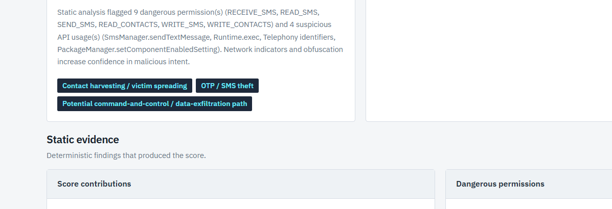
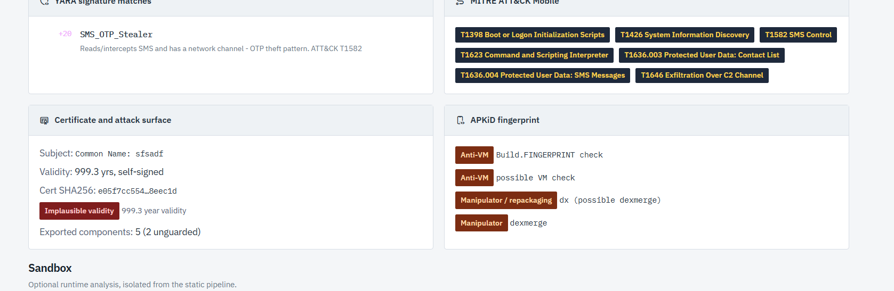

# Generative-AI APK Fraud Analyzer

Upload a suspicious Android APK → automated **static analysis** (manifest, permissions,
suspicious APIs, IOCs, obfuscation) → transparent **rule-based risk score** → **Gemini**
investigation report → PDF export. Built for banking-fraud / SOC first-level triage.

> The default `/api/analyze` pipeline is **strictly static** and never executes an APK.
> The dashboard submits that pipeline as a persisted background job, with bounded
> concurrency and phase-aware progress; `/api/analyze` remains compatible for API users.
> Runtime analysis is a separate, explicit `/api/dynamic` action that targets an attached
> isolated emulator only.

## Desktop application

The Electron desktop app starts and stops its own local Python engine, bundles the
dashboard assets, and stores desktop history and settings in the OS user-data folder.
From `desktop`, run `npm ci` and `npm start` after installing the backend dependencies.
See [desktop setup, tests, and packaging](desktop/README.md) for details.
For a Windows app that runs without installation, run `npm run portable` from
`desktop`. Its data stays in `APK Fraud Analyzer Data` beside the portable EXE.

## Dashboard

The analyst console keeps upload, deterministic triage, evidence review, optional AI,
and emulator-only runtime analysis visibly separated. It uses self-hosted Google Sans
Flex and the official Tabler outline icon family, with no frontend build step.


### Light mode analysis workspace

The light theme keeps the same dense analyst layout while adapting evidence labels,
severity colors, panel surfaces, and typography for a bright workspace.





### Real CIC MalDroid banking analysis

The populated views below come from a real 468,037-byte Banking-family APK extracted
from the [CIC MalDroid-2020 dataset](https://www.unb.ca/cic/datasets/maldroid-2020.html).
Its SHA256 is `a6408087c77ee164ace8800fa008a91ac2c41a004c7a0b940e7ccfe4fe591725`.
The APK was submitted only to `/api/analyze`; it was never installed or executed.

| Risk verdict and severity levels | Threat explanation and bounded agent |
|---|---|
|  |  |

| Score contributions and permissions | Suspicious APIs and network IOCs |
|---|---|
|  |  |

| YARA, MITRE, certificate, and APKiD | Emulator boundary and response plan |
|---|---|
|  |  |

Key UI capabilities:

- Drag-and-drop APK selection with clear static-analysis safety messaging.
- Folder batch selection with one persistent Folder History row per run, per-APK
  drill-down, and CSV export; batch mode uses the same bounded static pipeline and never
  runs APKs in the emulator.
- Explainable risk gauge, severity thresholds, score contributions, permissions, APIs, IOCs, signatures, and ATT&CK mapping.
- Bounded local/Gemini investigation with an auditable action trail.
- PDF and IOC exports, persisted sample history, and explicit emulator-only dynamic analysis.

## 📚 Full documentation

**[docs/](docs/README.md)** — a complete guide from pure basics to advanced internals:

| | | |
|---|---|---|
| [01 Foundations](docs/01-foundations.md) | [02 Threat Model](docs/02-threat-model.md) | [03 Architecture](docs/03-architecture.md) |
| [04 Static Pipeline](docs/04-static-analysis-pipeline.md) | [05 Risk Scoring](docs/05-risk-scoring.md) | [06 GenAI Reporting](docs/06-genai-reporting.md) |
| [07 Agentic Investigation](docs/07-agentic-investigation.md) | [08 ML Classifier](docs/08-ml-classifier.md) | [09 Dynamic Analysis](docs/09-dynamic-analysis.md) |
| [10 API Reference](docs/10-api-reference.md) | [11 Frontend](docs/11-frontend.md) | [12 Deployment & Ops](docs/12-deployment-and-ops.md) |
| [13 Evaluation & Accuracy](docs/13-evaluation-and-accuracy.md) | [14 Security Model](docs/14-security-model.md) | [15 Extending](docs/15-extending.md) |
| [16 Glossary](docs/16-glossary.md) | | |

## Quick start (Windows / PowerShell)

```powershell
cd backend
python -m venv .venv
.\.venv\Scripts\Activate.ps1
pip install -r requirements.txt

# optional — enables Gemini-written reports 
copy .env.example .env
# edit .env and set GEMINI_API_KEY=...   

# start the server — use the venv's Python so androguard is found:
.venv\Scripts\python.exe -m uvicorn app.main:app --reload --port 8000
```

> **Easiest:** just run **`run.bat`** (cmd) or **`.\run.ps1`** (PowerShell) from the
> `backend` folder — these always use the venv's Python, no activation needed.
>
> Activating with `Activate.ps1` only works in PowerShell. In **cmd.exe** it does
> nothing, so `uvicorn` falls back to global Python (no androguard) and analysis fails.
> The dashboard will show a red **"Engine offline"** badge and `/api/health` reports
> `"analyzer_ready": false` if this happens.

Open **http://localhost:8000** and drop in an `.apk`. Confirm
http://localhost:8000/api/health shows `"analyzer_ready": true` first.

To inspect a collection, select **Select APK folder**. The browser submits only `.apk`
files from that folder, and the dashboard shows independent queued/running/completed
states with a **View result** action for each sample. Completed runs appear as one row in
**Folder History**, separate from individual uploads in **Recent Analyses**. A folder
batch is static-only; dynamic analysis remains an explicit one-APK action.

### No APK to test with?

Generate a **harmless** synthetic sample (declares dangerous permissions + embeds
suspicious API/IOC strings, but contains no executable code and is unsigned, so it
cannot install on a real device):

```powershell
python tools\make_test_apk.py samples\test_fakebank.apk
```

Upload `samples/test_fakebank.apk` — it scores **100/100 Critical** and exercises every
detector (SMS/accessibility/overlay permissions, SmsManager/DexClassLoader APIs, fake
C2 domains + IP, a fake Telegram bot token, banking keywords, obfuscation signals).

- API docs: http://localhost:8000/docs
- Works with **no API key** — static analysis + scoring are fully local; only the
  natural-language report needs Gemini.

## What it does

| Stage | Module | Output |
|-------|--------|--------|
| Hash + metadata | `static_analyzer` | SHA256/MD5, package, version, SDKs |
| Permissions | `analyzer/permissions.py` | dangerous-permission catalog + weights |
| Certificate | `analyzer/cert_analysis.py` | unsigned / debug-cert / placeholder-identity red-flags |
| Attack surface | `analyzer/components.py` | exported activities/services/receivers/providers |
| Suspicious APIs | `analyzer/api_patterns.py` | SmsManager, AccessibilityService, DexClassLoader, … |
| IOCs | `analyzer/iocs.py` | URLs, IPs, domains, Telegram tokens, secrets, keywords — incl. **Base64/hex auto-decode** |
| Native libs | `static_analyzer._collect_native_strings` | scans bundled `.so` strings for hidden IOCs |
| Obfuscation | `analyzer/obfuscation.py` | short names, multi-dex, entropy, dynamic loading |
| YARA signatures | `analyzer/yara_scan.py` + `rules/android_fraud.yar` | malware-family signature matches (offline) |
| APKiD | `intel/apkid_scan.py` | compiler/packer/obfuscator/anti-analysis fingerprint (offline) |
| ML classifier | `ml/` | permission-based malware probability (RandomForest) |
| MITRE ATT&CK | `analyzer/mitre.py` | maps findings to ATT&CK Mobile technique IDs (offline) |
| Risk score | `analyzer/risk_scoring.py` | 0–100 + severity + itemised breakdown (hybrid: rules + ML) |
| Threat intel | `intel/virustotal.py` | VirusTotal multi-engine corroboration (optional) |
| Agentic investigation | `agent/` | bounded Ollama/Gemini evidence-tool loop + action audit |
| AI report | `genai/gemini_client.py` | exec summary, attack chain, recommendations |
| Export | `report.py` | PDF investigation report |

### VirusTotal (optional, free)

Set `VT_API_KEY` in `.env` (free key: https://www.virustotal.com/gui/my-apikey — 4 req/min,
500/day). The analyzer then looks up the APK's SHA256 + extracted domains against VirusTotal,
and shows the returned multi-engine detections as a separate corroboration panel. These
results never change the platform's own risk score, severity, or verdict. With no key
it is a silent no-op.

### AndroZoo evaluation sampling (research access)

AndroZoo is used for an independent, hash-pinned evaluation batch rather than silently
mixed into training. Put the personal key in `backend/.env` as `ANDROZOO_API_KEY`, never
commit it, and keep downloaded APKs inside the ignored `test/` directory.

```powershell
# The official nightly metadata is more than 2.7 GB compressed; download is resumable.
backend\.venv\Scripts\python.exe backend\tools\androzoo_pipeline.py fetch-metadata `
  --output test\androzoo\latest.csv.gz

# Deterministically choose a weak-label stress-test batch (not training ground truth).
backend\.venv\Scripts\python.exe backend\tools\androzoo_pipeline.py select `
  --metadata test\androzoo\latest.csv.gz `
  --manifest test\androzoo\evaluation-manifest.csv --benign 20 --malicious 20

# Four workers stays well below AndroZoo's requested concurrency ceiling.
backend\.venv\Scripts\python.exe backend\tools\androzoo_pipeline.py download `
  --manifest test\androzoo\evaluation-manifest.csv `
  --output test\androzoo\apks --workers 4
```

Every APK is written under its candidate label only after its SHA256 and metadata size
match. `vt_detection=0` is a sampling rule, not proof that an app is benign; manifests
retain scan dates and must be manually reviewed before any final accuracy claim. The
tool never installs or executes an APK. This batch measures cross-dataset behaviour only;
the primary model must be trained and evaluated with dataset-provided family/benign labels.

To resume all three stages and continue automatically, run
`powershell -ExecutionPolicy Bypass -File scripts\run_androzoo_evaluation.ps1`.

### AI Review (optional)

AI Review can select and sequence server-defined read-only evidence tools after the
static score is complete. Its automatic tools are read-only: manifest, permissions,
suspicious APIs, network indicators, signatures, attack surface, and score rationale.
Requests for external intelligence or emulator execution are recorded as
`approval_required` and are never executed by the agent. The model has no shell,
arbitrary filesystem, arbitrary HTTP, raw APK, or score-writing capability.

The recommended local model is `qwen3:8b`. OpenRouter can host the same open-weight
model family when local hardware is limited; Gemini can instead act as the planner or
review local hypotheses when `AGENT_GEMINI_REVIEW=true`.

```powershell
# One-time model installation (Ollama is already configured separately):
ollama pull qwen3:8b

# backend/.env
AGENT_ENABLED=true
AGENT_PROVIDER=ollama
OLLAMA_MODEL=qwen3:8b
AGENT_AUTO_RUN=false
AGENT_MAX_STEPS=8
AGENT_MAX_TOOL_CALLS=4
```

For hosted open-weight inference, keep the API key private and require OpenRouter's
zero-data-retention routing. The listed Qwen endpoint is low-cost and paid; free model
availability and privacy-compatible routing fluctuate, so select a currently available
free model explicitly when prototyping without credits.

```powershell
AGENT_PROVIDER=openrouter
OPENROUTER_API_KEY=sk-or-v1-your-key
OPENROUTER_MODEL=qwen/qwen3-30b-a3b-instruct-2507
OPENROUTER_ZDR=true
AGENT_OLLAMA_FALLBACK=false
```

The dashboard settings button in the top-right can change these values without
editing `.env`. It also controls the external-service gate, OpenRouter, Gemini and
VirusTotal credentials, runtime budgets, hosted/local models, and local GGUF import.
Settings are persisted in the selected PostgreSQL/SQLite database and the settings API is restricted
to loopback clients. Secret values are never returned to the browser after saving.

Large runtime features are optional downloads rather than part of the base package.
The same Settings dialog can pull either recommended Qwen model from Ollama, install
Google's Android emulator/API 35 sandbox files when Android Command-line Tools are
present, and cache the matching `frida-server` from official Frida GitHub releases.
Each entry shows its approximate size, installed state, and upstream source. Downloads
continue in the backend if the browser or Settings dialog is closed. CIC, AndroZoo, and
Drebin research datasets are deliberately excluded from end-user downloads.

With automatic mode off, analyze and save an APK first, then use the dashboard's
**Run AI Review** button or `POST /api/agent/investigate/{sample_id}`. Provider
status is available from `GET /api/agent/health`. CPU-only inference may take several
minutes, so execution is moved to a worker thread and does not block FastAPI's event
loop. A harmless live smoke test is available:

```powershell
cd backend
$env:AGENT_ENABLED="true"
.venv\Scripts\python.exe -u tools\smoke_agent.py
```

The genuinely agentic component is the additional experimental **Agentic Investigation**,
which can be enabled without changing AI Review or the manual sandbox:

```powershell
AGENT_WORKFLOW_ENABLED=true
```

Starting it creates a pending baseline proposal only. Each pass requires explicit user
approval, a re-upload whose SHA256 matches the stored case, and an attached dedicated
Android sandbox. The server—not the model or browser—selects one of four fixed actions:
baseline observation, Frida instrumentation, UI-tree exploration, or vision-assisted UI
exploration. Bounded runtime observations are fed back into the read-only evidence agent,
which may justify at most one next action. Raw APK bytes, logcat, screenshots, and device
paths are not stored in the workflow or sent to the evidence model. The deterministic
static score and severity remain locked. See
[`docs/07-agentic-investigation.md`](docs/07-agentic-investigation.md#13-optional-agentic-investigation-workflow).

The Agentic Investigation card includes a live activity feed for sandbox phases,
selected read-only tools, the model's stated action rationale, evidence counts, policy
rejections, and the final stop/continue decision. It intentionally does not display
private model chain-of-thought. **Allow visual-model follow-up** is selected in that card
before starting a new workflow; global availability remains controlled by Settings →
**Allow screenshot vision**. The per-workflow choice is then locked and the model cannot
enable vision on its own.

The risk score remains deterministic and is checked for immutability before and after
every agent run. Full design and threat controls are documented in
[`AGENTIC_AI_PLAN.md`](AGENTIC_AI_PLAN.md).

### Machine-learning classifier (optional)

The bundled `apk_static_model.joblib` is the 410-feature RandomForest trained from 500
CICMalDroid Banking and 500 CICMalDroid Benign APKs. Live inference uses the same
permissions, APIs, manifest/component counts, certificate flags, obfuscation, YARA,
APKiD, and IOC-shape fields used during extraction. `APK_STATIC_MODEL_PATH` can point to
another compatible artifact; the older permission-only `model.pkl` remains a fallback.
Because joblib uses Python deserialization, never load an artifact from an untrusted
source.

The model is a supporting local signal and cannot clear an APK. A probability below its
validated threshold is `not_flagged`, never proof of benignness. To rebuild the older
permission-only baseline:

```powershell
# 1) Smoke-test the pipeline with synthetic data (no download):
.venv\Scripts\python.exe -m app.ml.train --demo --out app\ml\model.pkl

# 2) Train for real on the Drebin dataset (ships pre-extracted feature files,
#    so no APK processing needed). Download Drebin, then:
.venv\Scripts\python.exe -m app.ml.train ^
    --data path\to\drebin\feature_vectors ^
    --labels path\to\drebin\sha256_family.csv ^
    --out app\ml\model.pkl

# Or train on the official CICMalDroid-2020 CSV.zip using only its static
# permission columns (the feature type reproduced by live APK analysis):
.venv\Scripts\python.exe -m app.ml.train `
    --maldroid-csv ..\test\CSV.zip `
    --out app\ml\model.pkl
```

`train.py` prints precision/recall/F1/ROC-AUC on a held-out split and saves the model +
fitted permission vocabulary + metrics. The classifier is a silent no-op if neither
model artifact is present. **Caveat:** cross-dataset drift still applies, so ML is never
the sole verdict.

For CICMalDroid training, the saved bundle selects a conservative alert threshold on
the held-out split (minimum 98% benign specificity). A probability below that threshold
is reported as `not_flagged`, never as proof that the APK is benign.

The CICMalDroid syscall/Binder CSVs are not fed to this static classifier: those are
runtime features and would cause train/serve drift. They can support a future dynamic
model once the sandbox extracts the same counters. CICMalDroid's static CSV does not
include APK hashes, so its random held-out score is a development baseline rather than
a campaign-deduplicated or temporal validation result.

### Accuracy and verdict policy

- Exact risky methods are matched with androguard callsites; a string-pool reference is
  labelled `reference` and down-weighted rather than described as an observed call.
- Ordinary embedded HTTPS links are reported but do not add risk. URL points require
  transparent properties such as a literal IP, higher-risk TLD, non-standard port, or a
  fraud/C2-like path.
- Isolated weak signals are kept small. Correlation bonuses represent discriminative
  fraud chains such as SMS access plus an outbound channel, accessibility plus overlay,
  and package installation plus runtime DEX loading.
- A heuristic `Critical` score means **Likely Malicious**, not confirmed. Confirmation is
  reserved for independent multi-engine corroboration.

Run the fast regression suite:

```powershell
cd backend
.venv\Scripts\python.exe -m unittest discover -s tests -v
```

## Dynamic analysis (emulator sandbox — Phase 3)

Optional runtime analysis in an attached Android emulator. The static pipeline never
runs the APK; **execution happens only here, only in your emulator, only when you click
"Run in Emulator."**

Use a **dedicated, isolated AVD** so malware never touches an emulator you use for other
things. A `FraudSandbox` AVD (android-35 / google_apis / x86_64 — rootable for Frida) is
the default target.

**One-command setup** — creates the AVD if missing, boots it, roots it, and downloads +
installs the matching `frida-server` (both tiers ready):

```powershell
.\scripts\setup_sandbox.ps1            # full setup (adb + Frida)
.\scripts\setup_sandbox.ps1 -NoFrida   # just boot the sandbox (adb tier only)
```

Or do it manually:

```powershell
avdmanager create avd -n FraudSandbox -k "system-images;android-35;google_apis;x86_64" -d pixel_6
emulator -avd FraudSandbox
# confirm: /api/health  ->  "dynamic": { "available": true, "sandbox_present": true }
```

**Safety:** auto-run only ever targets `FraudSandbox` (override with the `SANDBOX_AVD`
env var). If it isn't running, the engine *refuses* to auto-pick another device — you
must select one deliberately in the dashboard device dropdown. So a separate emulator
(e.g. one you use for other work) is never touched by accident.

Then upload a **real, signed** APK, pick the sandbox device, and hit **Run in
Emulator**. It installs → launches → captures **logcat, granted runtime permissions,
running services, network endpoints** → uninstalls, and produces a dynamic-behaviour
score. When the run is linked to the saved static case, the dashboard also shows an
explainable final score (`min(static + dynamic, 100)`) without changing either component
score. Tick **Frida hooks** for live API interception (SMS sends, HTTP URLs,
`DexClassLoader`, `Runtime.exec`, clipboard, crypto) — needs `frida-server` on the
emulator (the app shows setup steps if it's not). Endpoint: `POST /api/dynamic`
(`file`, `duration`, `use_frida`, `use_ui_agent`, `serial`, optional `sample_id`).

### AI UI Explorer (optional)

Set `UI_AGENT_ENABLED=true`, keep the dedicated `FraudSandbox` AVD running, then tick
**AI UI Explorer** for a dynamic-analysis pass. Ollama or OpenRouter reads a
sanitized accessibility-tree view and may choose only bounded tap, synthetic-text,
back, wait, or finish actions. The default fast UI model is `qwen3:1.7b`; configure it
independently with `UI_AGENT_PROVIDER` and `UI_AGENT_MODEL`.

Optional screenshot-guided fallback is available with `UI_AGENT_VISION_ENABLED=true`
and a vision-capable model. OpenRouter can use `qwen/qwen3-vl-8b-instruct`; local
Ollama can use `qwen3-vl:2b-instruct` as the CPU-friendly default, while
`qwen3-vl:4b` provides more capacity on a faster machine. Accessibility node actions
remain preferred. Visual taps use validated normalized coordinates, are restricted to
the foreground target app and safe screen margins, and appear in the action audit;
screenshots stay in memory and are not written to reports or the database.
For CPU inference, `UI_AGENT_IMAGE_MAX_EDGE=384` bounds the in-memory model image while
coordinate mapping continues to use the original device dimensions.
Vision turns use schema-validated JSON actions instead of Ollama native tools because
current Qwen3-VL native-tool requests can stall; both paths share the same policy gate.
Qwen's native 0–1000 GUI-coordinate form is normalized to audited percentages before
the safe-margin and foreground-package checks run.

The UI agent:

- receives element IDs, never raw screen coordinates;
- can type only server-generated fake identity fields (the reserved
  `example.invalid` email domain is used and passwords are redacted from results);
- blocks payment, purchase, transfer, call, install, delete, and external-navigation
  actions;
- retreats if an app control opens another package;
- refuses every target except the named `FraudSandbox` AVD and keeps a complete audit;
- is a separate pass from Frida so the two control loops cannot conflict.

An emulator reduces host exposure but does not make malware harmless. Keep the AVD
disposable, isolated from personal accounts/files, and reset it after testing. Apps
that render inaccessible custom canvases/WebViews may expose no actionable nodes; in
that case the agent stops instead of guessing coordinates.

> The synthetic `test_fakebank.apk` is unsigned with no real code — it won't
> install/run, so it's for **static** testing only. Use a real sample for dynamic, and
> run real malware in an **isolated** AVD (plan §14).

## Dashboard & exports
Upload, a risk gauge + itemised breakdown, AI explanation, YARA/MITRE/APKiD/ML/VirusTotal
panels, a certificate & attack-surface panel, a **Recent Analyses** history (click to
reload any past sample), and one-click exports: **PDF report**, **IOCs as CSV**, **IOCs as
JSON** (`/api/samples/{id}/iocs.csv|json`).

## Run in Docker (isolated)
Analyzing malware in a container keeps it off your host (plan §14). All deps ship
manylinux wheels, so the build needs no compiler:

```bash
POSTGRES_PASSWORD=choose-a-strong-password docker compose up --build
```
Dashboard on http://localhost:8000; Compose starts PostgreSQL and persists it in the
named `postgres-data` volume. Gemini, OpenRouter, and VirusTotal remain optional.

For a local one-command run, leave `DATABASE_URL` unset and SQLite is used automatically.
For Neon or another hosted PostgreSQL service, copy its pooled connection string into
`DATABASE_URL` in `backend/.env` (keep `sslmode=require`). To import existing SQLite
history, preview and then run:

```powershell
cd backend
.\.venv\Scripts\python.exe tools\migrate_sqlite_to_postgres.py --target $env:DATABASE_URL --dry-run
.\.venv\Scripts\python.exe tools\migrate_sqlite_to_postgres.py --target $env:DATABASE_URL
```

Persisted runtime settings may include API secrets and are therefore excluded by default;
add `--include-runtime-settings` only when that transfer is intentional.

## Tech
FastAPI · androguard (pure-Python, no Java/apktool/JADX needed) · Gemini · PostgreSQL/SQLite ·
reportlab · vanilla JS + Tailwind + Chart.js dashboard.

## Project layout
```
backend/app/
  main.py              FastAPI routes + static serving
  analyzer/            static analysis + scoring
  dynamic/ui_agent.py bounded synthetic-data Android UI exploration
  genai/gemini_client  LLM report (+ template fallback)
  db.py  report.py     PostgreSQL/SQLite adapter + PDF
frontend/              index.html + app.js (served by FastAPI)
plan.md                full product vision
AGENTIC_AI_PLAN.md     bounded local-Ollama + optional-Gemini investigation plan
```
