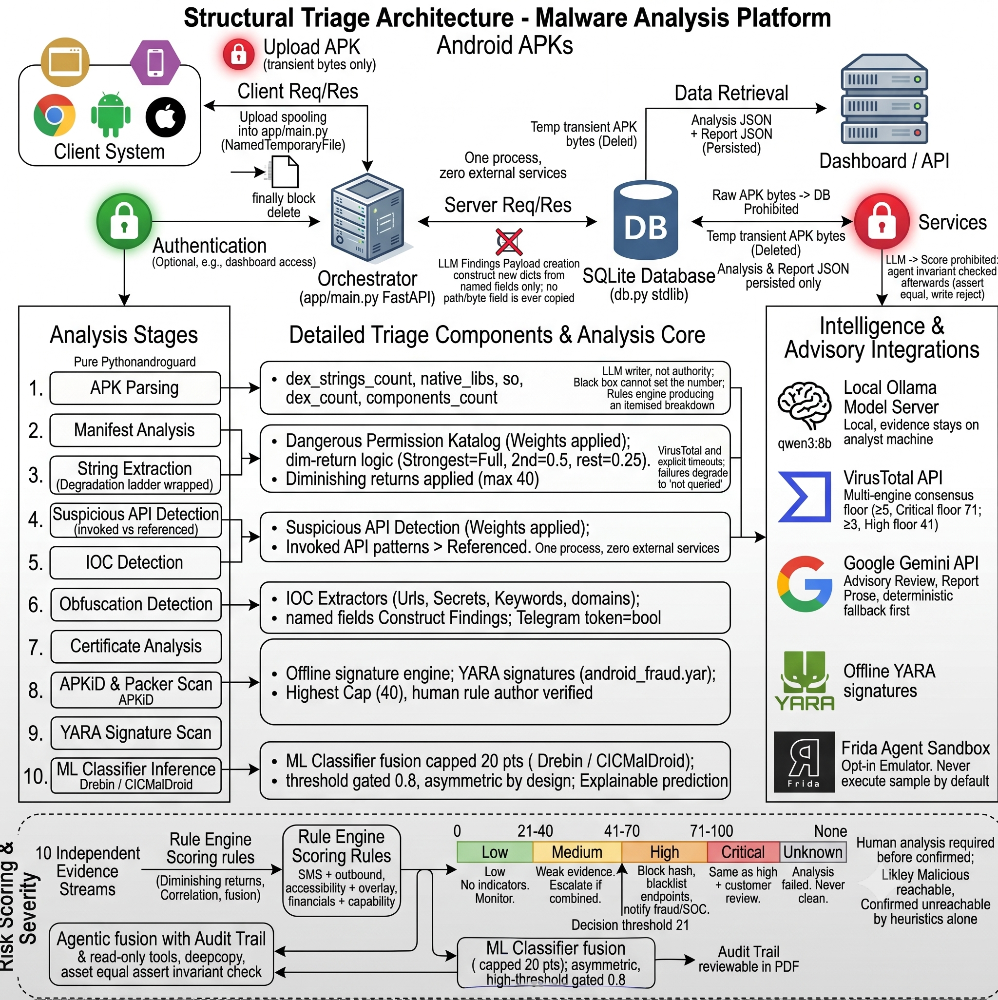
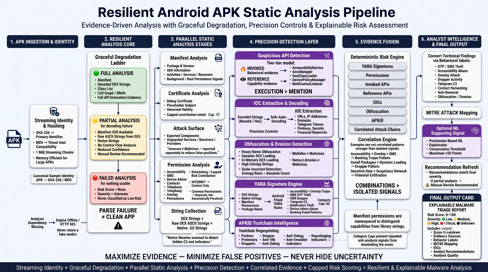
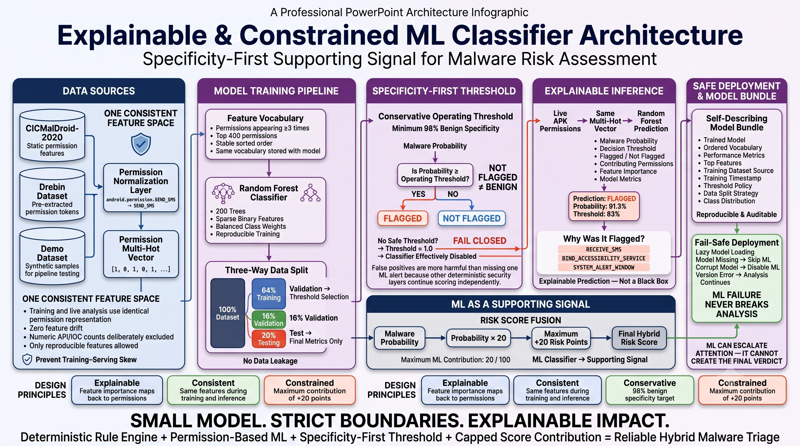

# Generative-AI APK Fraud Analyzer

Upload a suspicious Android APK → automated **static analysis** (manifest, permissions,
suspicious APIs, IOCs, obfuscation) → transparent **rule-based risk score** → **Gemini**
investigation report → PDF export. Built for banking-fraud / SOC first-level triage.

> Static analysis only — uploaded APKs are **never executed**. See `plan.md` for the full
> roadmap (dynamic sandbox + ML classifier are future phases).

## System Architecture



## Quick start (Windows / PowerShell)

```powershell
cd backend
python -m venv .venv
.\.venv\Scripts\Activate.ps1
pip install -r requirements.txt

# optional — enables Gemini-written reports 
copy .env.example .env
# edit .env and set GEMINI_API_KEY=...   

# start the server — use the venv's Python so androguard is found:
.venv\Scripts\python.exe -m uvicorn app.main:app --reload --port 8000
````

> **Easiest:** just run **`run.bat`** (cmd) or **`.\run.ps1`** (PowerShell) from the
> `backend` folder — these always use the venv's Python, no activation needed.
>
> Activating with `Activate.ps1` only works in PowerShell. In **cmd.exe** it does
> nothing, so `uvicorn` falls back to global Python (no androguard) and analysis fails.
> The dashboard will show a red **"Engine offline"** badge and `/api/health` reports
> `"analyzer_ready": false` if this happens.

Open **[http://localhost:8000](http://localhost:8000)** and drop in an `.apk`. Confirm
[http://localhost:8000/api/health](http://localhost:8000/api/health) shows `"analyzer_ready": true` first.

### No APK to test with?

Generate a **harmless** synthetic sample (declares dangerous permissions + embeds
suspicious API/IOC strings, but contains no executable code and is unsigned, so it
cannot install on a real device):

```powershell
python tools\make_test_apk.py samples\test_fakebank.apk
```

Upload `samples/test_fakebank.apk` — it scores **100/100 Critical** and exercises every
detector (SMS/accessibility/overlay permissions, SmsManager/DexClassLoader APIs, fake
C2 domains + IP, a fake Telegram bot token, banking keywords, obfuscation signals).

* API docs: [http://localhost:8000/docs](http://localhost:8000/docs)
* Works with **no API key** — static analysis + scoring are fully local; only the
  natural-language report needs Gemini.

## What it does

| Stage           | Module                                              | Output                                                                                    |
| --------------- | --------------------------------------------------- | ----------------------------------------------------------------------------------------- |
| Hash + metadata | `static_analyzer`                                   | SHA256/MD5, package, version, SDKs                                                        |
| Permissions     | `analyzer/permissions.py`                           | dangerous-permission catalog + weights                                                    |
| Certificate     | `analyzer/cert_analysis.py`                         | unsigned / debug-cert / placeholder-identity red-flags                                    |
| Attack surface  | `analyzer/components.py`                            | exported activities/services/receivers/providers                                          |
| Suspicious APIs | `analyzer/api_patterns.py`                          | SmsManager, AccessibilityService, DexClassLoader, …                                       |
| IOCs            | `analyzer/iocs.py`                                  | URLs, IPs, domains, Telegram tokens, secrets, keywords — incl. **Base64/hex auto-decode** |
| Native libs     | `static_analyzer._collect_native_strings`           | scans bundled `.so` strings for hidden IOCs                                               |
| Obfuscation     | `analyzer/obfuscation.py`                           | short names, multi-dex, entropy, dynamic loading                                          |
| YARA signatures | `analyzer/yara_scan.py` + `rules/android_fraud.yar` | malware-family signature matches (offline)                                                |
| APKiD           | `intel/apkid_scan.py`                               | compiler/packer/obfuscator/anti-analysis fingerprint (offline)                            |
| ML classifier   | `ml/`                                               | permission-based malware probability (RandomForest)                                       |
| MITRE ATT&CK    | `analyzer/mitre.py`                                 | maps findings to ATT&CK Mobile technique IDs (offline)                                    |
| Risk score      | `analyzer/risk_scoring.py`                          | 0–100 + severity + itemised breakdown (hybrid: rules + ML)                                |
| Threat intel    | `intel/virustotal.py`                               | VirusTotal multi-engine corroboration (optional)                                          |
| AI report       | `genai/gemini_client.py`                            | exec summary, attack chain, recommendations                                               |
| Export          | `report.py`                                         | PDF investigation report                                                                  |

## Static Analysis Pipeline



### VirusTotal (optional, free)

Set `VT_API_KEY` in `.env` (free key: [https://www.virustotal.com/gui/my-apikey](https://www.virustotal.com/gui/my-apikey) — 4 req/min,
500/day). The analyzer then looks up the APK's SHA256 + extracted domains against VirusTotal,
shows real multi-engine detections, and folds them into the risk score (a confirmed
multi-engine hit floors severity at High/Critical). With no key it's a silent no-op.

### Machine-learning classifier (optional)



A permission-based RandomForest gives a data-driven malware probability that's folded
into the hybrid score (plan §7). A **demo model** (trained on synthetic data) ships so
the ML panel works out of the box — replace it with a real one:

```powershell
# 1) Smoke-test the pipeline with synthetic data (no download):
.venv\Scripts\python.exe -m app.ml.train --demo --out app\ml\model.pkl

# 2) Train for real on the Drebin dataset (ships pre-extracted feature files,
#    so no APK processing needed). Download Drebin, then:
.venv\Scripts\python.exe -m app.ml.train ^
    --data path\to\drebin\feature_vectors ^
    --labels path\to\drebin\sha256_family.csv ^
    --out app\ml\model.pkl
```

`train.py` prints precision/recall/F1/ROC-AUC on a held-out split and saves the model +
fitted permission vocabulary + metrics. The classifier is a silent no-op if no
`model.pkl` is present. **Caveat:** Drebin is ~2014-era, so treat the ML output as a
corroborating signal (concept drift), not a sole verdict.

## Dynamic analysis (emulator sandbox — Phase 3)

Optional runtime analysis in an attached Android emulator. The static pipeline never
runs the APK; **execution happens only here, only in your emulator, only when you click
"Run in Emulator."**

Use a **dedicated, isolated AVD** so malware never touches an emulator you use for other
things. A `FraudSandbox` AVD (android-35 / google_apis / x86_64 — rootable for Frida) is
the default target.

**One-command setup** — creates the AVD if missing, boots it, roots it, and downloads +
installs the matching `frida-server` (both tiers ready):

```powershell
.\scripts\setup_sandbox.ps1            # full setup (adb + Frida)
.\scripts\setup_sandbox.ps1 -NoFrida   # just boot the sandbox (adb tier only)
```

Or do it manually:

```powershell
avdmanager create avd -n FraudSandbox -k "system-images;android-35;google_apis;x86_64" -d pixel_6
emulator -avd FraudSandbox
# confirm: /api/health  ->  "dynamic": { "available": true, "sandbox_present": true }
```

**Safety:** auto-run only ever targets `FraudSandbox` (override with the `SANDBOX_AVD`
env var). If it isn't running, the engine *refuses* to auto-pick another device — you
must select one deliberately in the dashboard device dropdown. So a separate emulator
(e.g. one you use for other work) is never touched by accident.

Then upload a **real, signed** APK, pick the sandbox device, and hit **Run in
Emulator**. It installs → launches → captures **logcat, granted runtime permissions,
running services, network endpoints** → uninstalls, and produces a dynamic-behaviour
score. Tick **Frida hooks** for live API interception (SMS sends, HTTP URLs,
`DexClassLoader`, `Runtime.exec`, clipboard, crypto) — needs `frida-server` on the
emulator (the app shows setup steps if it's not). Endpoint: `POST /api/dynamic`
(`file`, `duration`, `use_frida`, `serial`).

> The synthetic `test_fakebank.apk` is unsigned with no real code — it won't
> install/run, so it's for **static** testing only. Use a real sample for dynamic, and
> run real malware in an **isolated** AVD (plan §14).

## Dashboard & exports

Upload, a risk gauge + itemised breakdown, AI explanation, YARA/MITRE/APKiD/ML/VirusTotal
panels, a certificate & attack-surface panel, a **Recent Analyses** history (click to
reload any past sample), and one-click exports: **PDF report**, **IOCs as CSV**, **IOCs as
JSON** (`/api/samples/{id}/iocs.csv|json`).

## Run in Docker (isolated)

Analyzing malware in a container keeps it off your host (plan §14). All deps ship
manylinux wheels, so the build needs no compiler:

```bash
GEMINI_API_KEY=... VT_API_KEY=... docker compose up --build
```

Dashboard on [http://localhost:8000](http://localhost:8000); the SQLite history persists in `backend/data/`.

## Tech

FastAPI · androguard (pure-Python, no Java/apktool/JADX needed) · Gemini · SQLite ·
reportlab · vanilla JS + Tailwind + Chart.js dashboard.

## Project layout

```
backend/app/
  main.py              FastAPI routes + static serving
  analyzer/            static analysis + scoring
  genai/gemini_client  LLM report (+ template fallback)
  db.py  report.py     SQLite + PDF
frontend/              index.html + app.js (served by FastAPI)
archi.png              system architecture
staticpipeline.png     static analysis pipeline
mlclassifer.png        ML classifier
plan.md                full product vision
```

```
```
