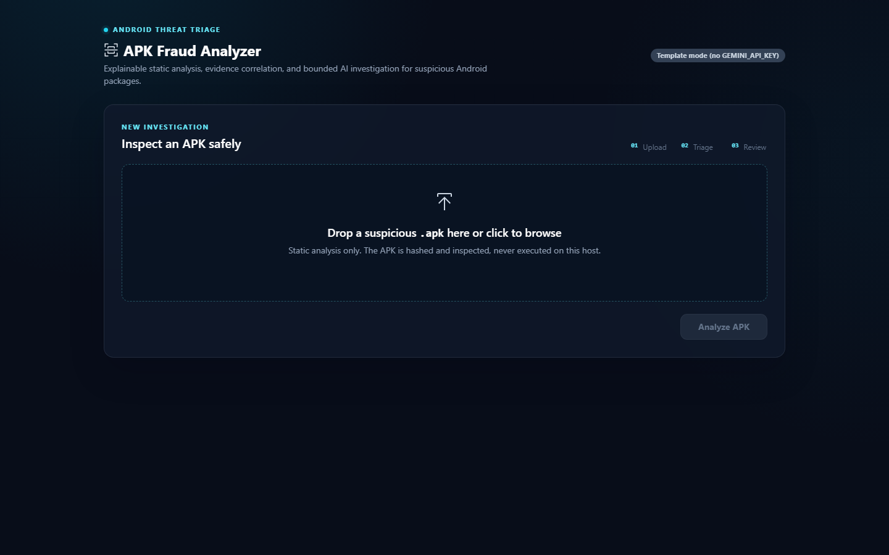
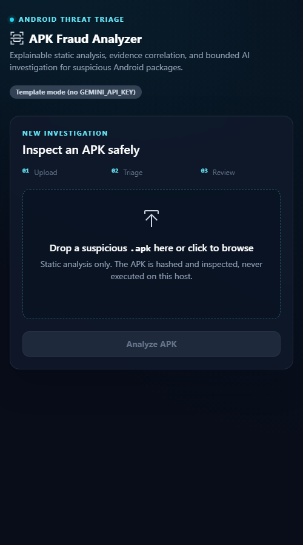
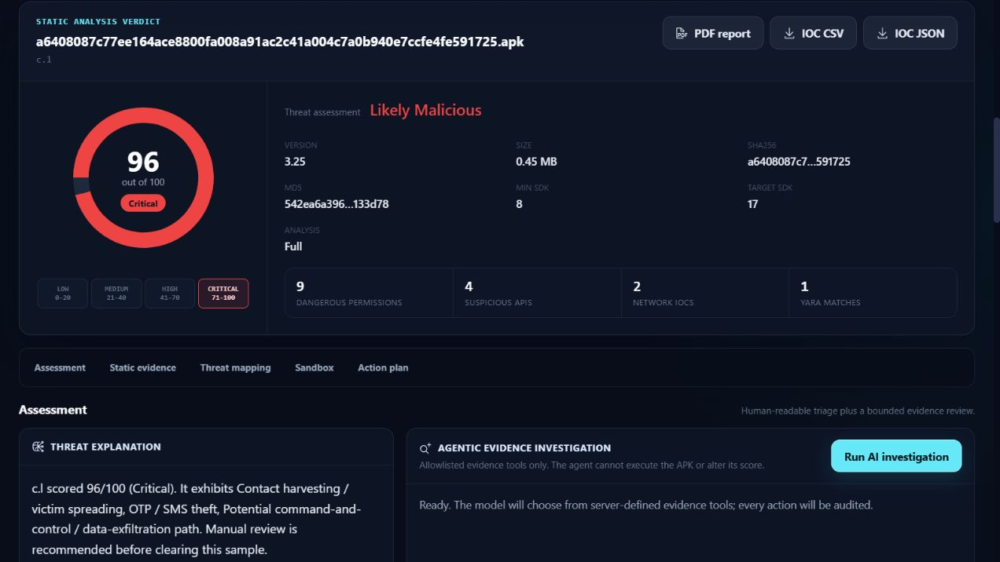
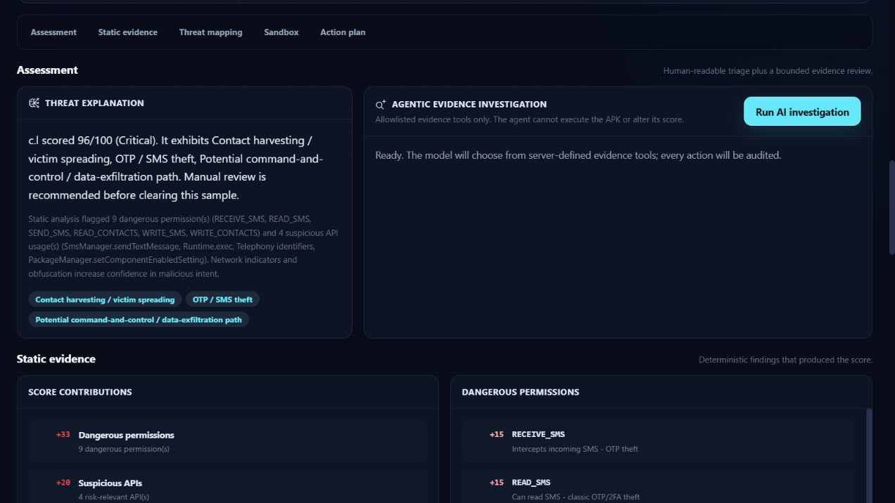
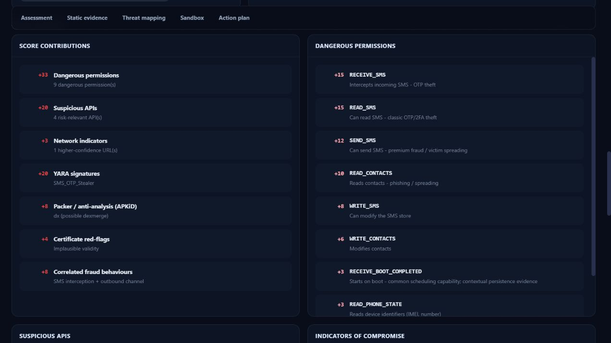
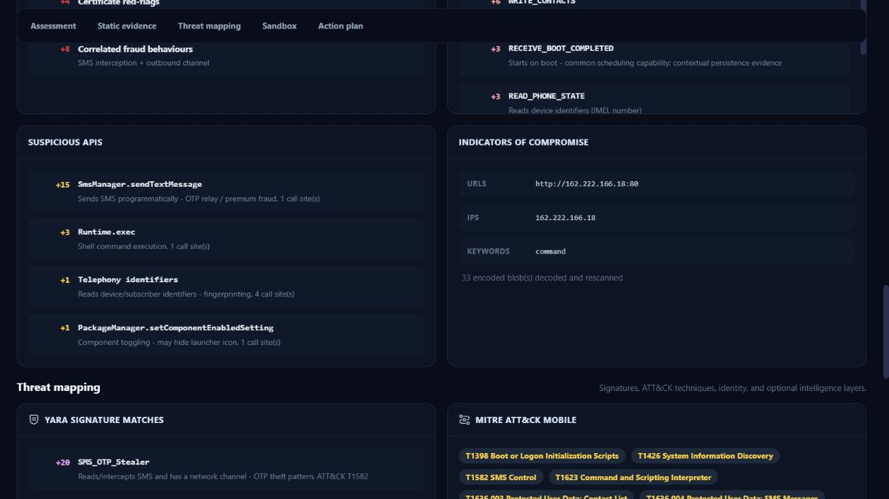
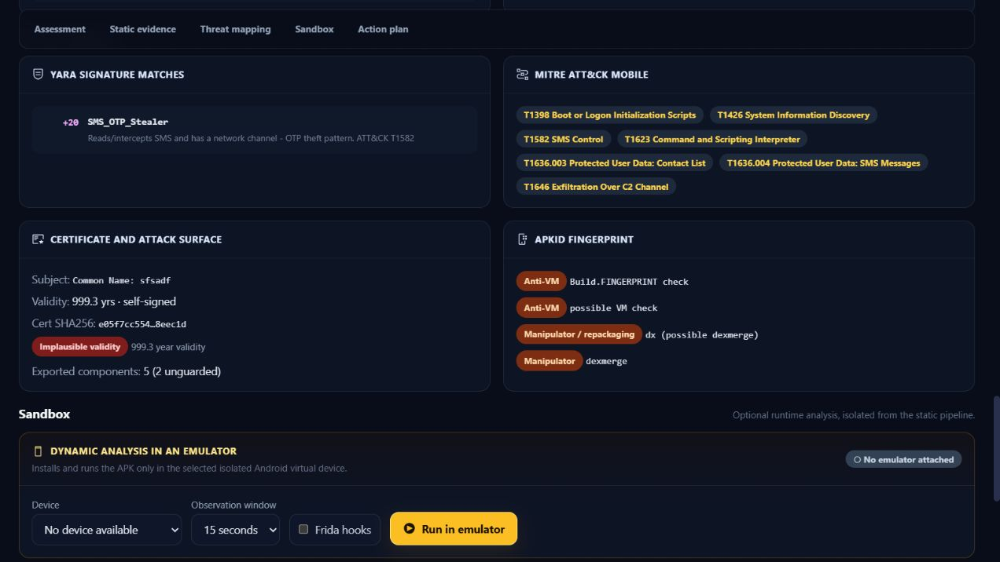
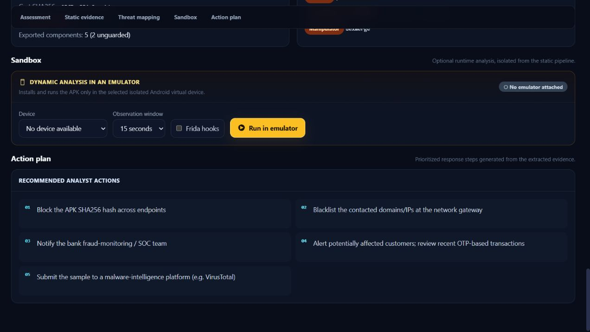

# Generative-AI APK Fraud Analyzer

Upload a suspicious Android APK → automated **static analysis** (manifest, permissions,
suspicious APIs, IOCs, obfuscation) → transparent **rule-based risk score** → **Gemini**
investigation report → PDF export. Built for banking-fraud / SOC first-level triage.

> The default `/api/analyze` pipeline is **strictly static** and never executes an APK.
> Runtime analysis is a separate, explicit `/api/dynamic` action that targets an attached
> isolated emulator only.

## Dashboard

The analyst console keeps upload, deterministic triage, evidence review, optional AI,
and emulator-only runtime analysis visibly separated. It uses the IBM Carbon icon
language and does not need a frontend build step.

| Upload workspace | Compact responsive layout |
|---|---|
|  |  |

### Real CIC MalDroid banking analysis

The populated views below come from a real 468,037-byte Banking-family APK extracted
from the [CIC MalDroid-2020 dataset](https://www.unb.ca/cic/datasets/maldroid-2020.html).
Its SHA256 is `a6408087c77ee164ace8800fa008a91ac2c41a004c7a0b940e7ccfe4fe591725`.
The APK was submitted only to `/api/analyze`; it was never installed or executed.

| Risk verdict and severity levels | Threat explanation and bounded agent |
|---|---|
|  |  |

| Score contributions and permissions | Suspicious APIs and network IOCs |
|---|---|
|  |  |

| YARA, MITRE, certificate, and APKiD | Emulator boundary and response plan |
|---|---|
|  |  |

Key UI capabilities:

- Drag-and-drop APK selection with clear static-analysis safety messaging.
- Explainable risk gauge, severity thresholds, score contributions, permissions, APIs, IOCs, signatures, and ATT&CK mapping.
- Bounded local/Gemini investigation with an auditable action trail.
- PDF and IOC exports, persisted sample history, and explicit emulator-only dynamic analysis.

## 📚 Full documentation

**[docs/](docs/README.md)** — a complete guide from pure basics to advanced internals:

| | | |
|---|---|---|
| [01 Foundations](docs/01-foundations.md) | [02 Threat Model](docs/02-threat-model.md) | [03 Architecture](docs/03-architecture.md) |
| [04 Static Pipeline](docs/04-static-analysis-pipeline.md) | [05 Risk Scoring](docs/05-risk-scoring.md) | [06 GenAI Reporting](docs/06-genai-reporting.md) |
| [07 Agentic Investigation](docs/07-agentic-investigation.md) | [08 ML Classifier](docs/08-ml-classifier.md) | [09 Dynamic Analysis](docs/09-dynamic-analysis.md) |
| [10 API Reference](docs/10-api-reference.md) | [11 Frontend](docs/11-frontend.md) | [12 Deployment & Ops](docs/12-deployment-and-ops.md) |
| [13 Evaluation & Accuracy](docs/13-evaluation-and-accuracy.md) | [14 Security Model](docs/14-security-model.md) | [15 Extending](docs/15-extending.md) |
| [16 Glossary](docs/16-glossary.md) | | |

## Quick start (Windows / PowerShell)

```powershell
cd backend
python -m venv .venv
.\.venv\Scripts\Activate.ps1
pip install -r requirements.txt

# optional — enables Gemini-written reports 
copy .env.example .env
# edit .env and set GEMINI_API_KEY=...   

# start the server — use the venv's Python so androguard is found:
.venv\Scripts\python.exe -m uvicorn app.main:app --reload --port 8000
```

> **Easiest:** just run **`run.bat`** (cmd) or **`.\run.ps1`** (PowerShell) from the
> `backend` folder — these always use the venv's Python, no activation needed.
>
> Activating with `Activate.ps1` only works in PowerShell. In **cmd.exe** it does
> nothing, so `uvicorn` falls back to global Python (no androguard) and analysis fails.
> The dashboard will show a red **"Engine offline"** badge and `/api/health` reports
> `"analyzer_ready": false` if this happens.

Open **http://localhost:8000** and drop in an `.apk`. Confirm
http://localhost:8000/api/health shows `"analyzer_ready": true` first.

### No APK to test with?

Generate a **harmless** synthetic sample (declares dangerous permissions + embeds
suspicious API/IOC strings, but contains no executable code and is unsigned, so it
cannot install on a real device):

```powershell
python tools\make_test_apk.py samples\test_fakebank.apk
```

Upload `samples/test_fakebank.apk` — it scores **100/100 Critical** and exercises every
detector (SMS/accessibility/overlay permissions, SmsManager/DexClassLoader APIs, fake
C2 domains + IP, a fake Telegram bot token, banking keywords, obfuscation signals).

- API docs: http://localhost:8000/docs
- Works with **no API key** — static analysis + scoring are fully local; only the
  natural-language report needs Gemini.

## What it does

| Stage | Module | Output |
|-------|--------|--------|
| Hash + metadata | `static_analyzer` | SHA256/MD5, package, version, SDKs |
| Permissions | `analyzer/permissions.py` | dangerous-permission catalog + weights |
| Certificate | `analyzer/cert_analysis.py` | unsigned / debug-cert / placeholder-identity red-flags |
| Attack surface | `analyzer/components.py` | exported activities/services/receivers/providers |
| Suspicious APIs | `analyzer/api_patterns.py` | SmsManager, AccessibilityService, DexClassLoader, … |
| IOCs | `analyzer/iocs.py` | URLs, IPs, domains, Telegram tokens, secrets, keywords — incl. **Base64/hex auto-decode** |
| Native libs | `static_analyzer._collect_native_strings` | scans bundled `.so` strings for hidden IOCs |
| Obfuscation | `analyzer/obfuscation.py` | short names, multi-dex, entropy, dynamic loading |
| YARA signatures | `analyzer/yara_scan.py` + `rules/android_fraud.yar` | malware-family signature matches (offline) |
| APKiD | `intel/apkid_scan.py` | compiler/packer/obfuscator/anti-analysis fingerprint (offline) |
| ML classifier | `ml/` | permission-based malware probability (RandomForest) |
| MITRE ATT&CK | `analyzer/mitre.py` | maps findings to ATT&CK Mobile technique IDs (offline) |
| Risk score | `analyzer/risk_scoring.py` | 0–100 + severity + itemised breakdown (hybrid: rules + ML) |
| Threat intel | `intel/virustotal.py` | VirusTotal multi-engine corroboration (optional) |
| Agentic investigation | `agent/` | bounded Ollama/Gemini evidence-tool loop + action audit |
| AI report | `genai/gemini_client.py` | exec summary, attack chain, recommendations |
| Export | `report.py` | PDF investigation report |

### VirusTotal (optional, free)

Set `VT_API_KEY` in `.env` (free key: https://www.virustotal.com/gui/my-apikey — 4 req/min,
500/day). The analyzer then looks up the APK's SHA256 + extracted domains against VirusTotal,
shows real multi-engine detections, and folds them into the risk score (a confirmed
multi-engine hit floors severity at High/Critical). With no key it's a silent no-op.

### Bounded agentic investigation (optional)

The agent can autonomously select and sequence server-defined evidence tools after the
static score is complete. Its automatic tools are read-only: manifest, permissions,
suspicious APIs, network indicators, signatures, attack surface, and score rationale.
Requests for external intelligence or emulator execution are recorded as
`approval_required` and are never executed by the agent. The model has no shell,
arbitrary filesystem, arbitrary HTTP, raw APK, or score-writing capability.

The recommended local model is `qwen3:8b`; Gemini can instead act as the planner with
`AGENT_PROVIDER=gemini`, or review local hypotheses when `AGENT_GEMINI_REVIEW=true`.

```powershell
# One-time model installation (Ollama is already configured separately):
ollama pull qwen3:8b

# backend/.env
AGENT_ENABLED=true
AGENT_PROVIDER=ollama
OLLAMA_MODEL=qwen3:8b
AGENT_AUTO_RUN=false
AGENT_MAX_STEPS=8
AGENT_MAX_TOOL_CALLS=4
```

With automatic mode off, analyze and save an APK first, then use the dashboard's
**Run AI Investigation** button or `POST /api/agent/investigate/{sample_id}`. Provider
status is available from `GET /api/agent/health`. CPU-only inference may take several
minutes, so execution is moved to a worker thread and does not block FastAPI's event
loop. A harmless live smoke test is available:

```powershell
cd backend
$env:AGENT_ENABLED="true"
.venv\Scripts\python.exe -u tools\smoke_agent.py
```

The risk score remains deterministic and is checked for immutability before and after
every agent run. Full design and threat controls are documented in
[`AGENTIC_AI_PLAN.md`](AGENTIC_AI_PLAN.md).

### Machine-learning classifier (optional)

A permission-based RandomForest can provide a corroborating malware probability. No
model is trusted or enabled by default; train a demo model only to smoke-test the wiring,
then replace it with a versioned model trained and evaluated on real data:

```powershell
# 1) Smoke-test the pipeline with synthetic data (no download):
.venv\Scripts\python.exe -m app.ml.train --demo --out app\ml\model.pkl

# 2) Train for real on the Drebin dataset (ships pre-extracted feature files,
#    so no APK processing needed). Download Drebin, then:
.venv\Scripts\python.exe -m app.ml.train ^
    --data path\to\drebin\feature_vectors ^
    --labels path\to\drebin\sha256_family.csv ^
    --out app\ml\model.pkl

# Or train on the official CICMalDroid-2020 CSV.zip using only its static
# permission columns (the feature type reproduced by live APK analysis):
.venv\Scripts\python.exe -m app.ml.train `
    --maldroid-csv ..\test\CSV.zip `
    --out app\ml\model.pkl
```

`train.py` prints precision/recall/F1/ROC-AUC on a held-out split and saves the model +
fitted permission vocabulary + metrics. The classifier is a silent no-op if no
`model.pkl` is present. **Caveat:** Drebin is ~2014-era, so treat the ML output as a
corroborating signal (concept drift), not a sole verdict.

For CICMalDroid training, the saved bundle selects a conservative alert threshold on
the held-out split (minimum 98% benign specificity). A probability below that threshold
is reported as `not_flagged`, never as proof that the APK is benign.

The CICMalDroid syscall/Binder CSVs are not fed to this static classifier: those are
runtime features and would cause train/serve drift. They can support a future dynamic
model once the sandbox extracts the same counters. CICMalDroid's static CSV does not
include APK hashes, so its random held-out score is a development baseline rather than
a campaign-deduplicated or temporal validation result.

### Accuracy and verdict policy

- Exact risky methods are matched with androguard callsites; a string-pool reference is
  labelled `reference` and down-weighted rather than described as an observed call.
- Ordinary embedded HTTPS links are reported but do not add risk. URL points require
  transparent properties such as a literal IP, higher-risk TLD, non-standard port, or a
  fraud/C2-like path.
- Isolated weak signals are kept small. Correlation bonuses represent discriminative
  fraud chains such as SMS access plus an outbound channel, accessibility plus overlay,
  and package installation plus runtime DEX loading.
- A heuristic `Critical` score means **Likely Malicious**, not confirmed. Confirmation is
  reserved for independent multi-engine corroboration.

Run the fast regression suite:

```powershell
cd backend
.venv\Scripts\python.exe -m unittest discover -s tests -v
```

## Dynamic analysis (emulator sandbox — Phase 3)

Optional runtime analysis in an attached Android emulator. The static pipeline never
runs the APK; **execution happens only here, only in your emulator, only when you click
"Run in Emulator."**

Use a **dedicated, isolated AVD** so malware never touches an emulator you use for other
things. A `FraudSandbox` AVD (android-35 / google_apis / x86_64 — rootable for Frida) is
the default target.

**One-command setup** — creates the AVD if missing, boots it, roots it, and downloads +
installs the matching `frida-server` (both tiers ready):

```powershell
.\scripts\setup_sandbox.ps1            # full setup (adb + Frida)
.\scripts\setup_sandbox.ps1 -NoFrida   # just boot the sandbox (adb tier only)
```

Or do it manually:

```powershell
avdmanager create avd -n FraudSandbox -k "system-images;android-35;google_apis;x86_64" -d pixel_6
emulator -avd FraudSandbox
# confirm: /api/health  ->  "dynamic": { "available": true, "sandbox_present": true }
```

**Safety:** auto-run only ever targets `FraudSandbox` (override with the `SANDBOX_AVD`
env var). If it isn't running, the engine *refuses* to auto-pick another device — you
must select one deliberately in the dashboard device dropdown. So a separate emulator
(e.g. one you use for other work) is never touched by accident.

Then upload a **real, signed** APK, pick the sandbox device, and hit **Run in
Emulator**. It installs → launches → captures **logcat, granted runtime permissions,
running services, network endpoints** → uninstalls, and produces a dynamic-behaviour
score. Tick **Frida hooks** for live API interception (SMS sends, HTTP URLs,
`DexClassLoader`, `Runtime.exec`, clipboard, crypto) — needs `frida-server` on the
emulator (the app shows setup steps if it's not). Endpoint: `POST /api/dynamic`
(`file`, `duration`, `use_frida`, `serial`).

> The synthetic `test_fakebank.apk` is unsigned with no real code — it won't
> install/run, so it's for **static** testing only. Use a real sample for dynamic, and
> run real malware in an **isolated** AVD (plan §14).

## Dashboard & exports
Upload, a risk gauge + itemised breakdown, AI explanation, YARA/MITRE/APKiD/ML/VirusTotal
panels, a certificate & attack-surface panel, a **Recent Analyses** history (click to
reload any past sample), and one-click exports: **PDF report**, **IOCs as CSV**, **IOCs as
JSON** (`/api/samples/{id}/iocs.csv|json`).

## Run in Docker (isolated)
Analyzing malware in a container keeps it off your host (plan §14). All deps ship
manylinux wheels, so the build needs no compiler:

```bash
GEMINI_API_KEY=... VT_API_KEY=... docker compose up --build
```
Dashboard on http://localhost:8000; the SQLite history persists in `backend/data/`.

## Tech
FastAPI · androguard (pure-Python, no Java/apktool/JADX needed) · Gemini · SQLite ·
reportlab · vanilla JS + Tailwind + Chart.js dashboard.

## Project layout
```
backend/app/
  main.py              FastAPI routes + static serving
  analyzer/            static analysis + scoring
  genai/gemini_client  LLM report (+ template fallback)
  db.py  report.py     SQLite + PDF
frontend/              index.html + app.js (served by FastAPI)
plan.md                full product vision
AGENTIC_AI_PLAN.md     bounded local-Ollama + optional-Gemini investigation plan
```
