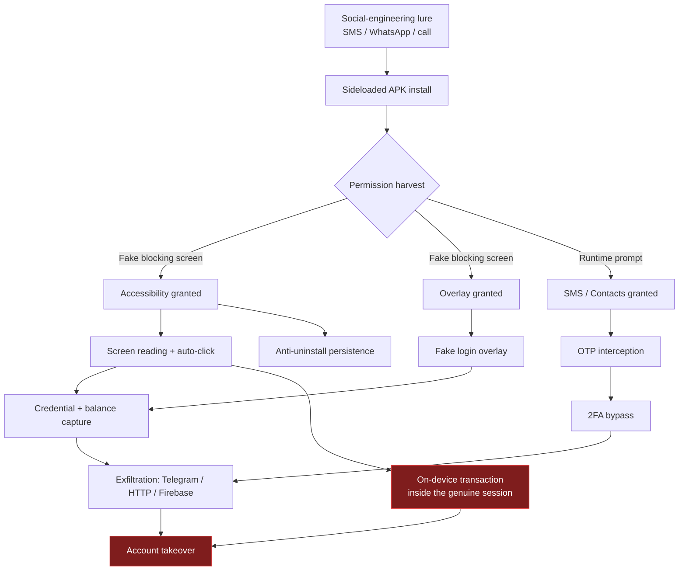

# 02 — Threat Model: Android Banking Fraud

> What the platform is actually hunting, how each attack works mechanically, and which
> observable static artefacts it leaves behind.

---

## 1. The distribution problem

Almost no fraudulent banking APK reaches a victim through an official app store. The
delivery chain looks like this:

```
  Attacker builds/repackages APK
            │
            ▼
  Hosted on a throwaway domain, a file-sharing link, or a Telegram channel
            │
            ▼
  Social-engineering lure delivered by SMS / WhatsApp / call
  ("Your KYC expires today — install this to re-verify")
            │
            ▼
  Victim enables "Install unknown apps", installs the APK
            │
            ▼
  App demands special-access permissions with a fake blocking screen
  ("Enable Accessibility to continue setup")
            │
            ▼
  Fraud executes: OTP interception, overlay credential theft, remote control
```

Two consequences shape the whole product:

1. **Triage volume is the problem, not deep reverse engineering.** A bank's fraud desk
   receives hundreds of suspect APKs from customers. They need a fast, explainable
   ranking — which is exactly what this platform produces.
2. **The sample is untrusted and often malformed.** Every parser must be defensive.

---

## 2. Attack taxonomy

Each subsection below states the mechanism, the static artefacts, and the detector that
catches it.

### 2.1 SMS / OTP interception

**Mechanism.** The app registers a `BroadcastReceiver` for
`android.provider.Telephony.SMS_RECEIVED` (or reads the SMS content provider), extracts
the one-time password from incoming bank messages, and forwards it to the attacker over
HTTP or a Telegram bot. The victim's own banking app never shows the OTP because on
older Android the receiver can abort the broadcast, and on newer Android the malware
simply reads it first and the victim is told "verification in progress".

**Static artefacts.**

| Artefact | Where found |
|---|---|
| `READ_SMS`, `RECEIVE_SMS` permissions | manifest |
| `SMS_RECEIVED` intent filter on an exported receiver | manifest |
| `SmsManager.sendTextMessage` callsite | DEX call graph |
| `INTERNET` + an embedded endpoint | manifest + string pool |

**Detectors.** `permissions.py` (weight 15 each), `api_patterns.py`
(`SmsManager.sendTextMessage`), YARA rule `SMS_OTP_Stealer` (score 20), and the
correlation rule **"SMS interception + outbound channel"** (+8).

**MITRE.** `T1582` SMS Control, `T1636.004` Protected User Data: SMS Messages.

---

### 2.2 Overlay attacks (fake login screens)

**Mechanism.** With `SYSTEM_ALERT_WINDOW`, the app can draw a window on top of every
other app. It detects that the real banking app has come to the foreground and instantly
draws a pixel-perfect replica of its login screen over it. The victim types real
credentials into the attacker's view.

**Why this is subtle.** `SYSTEM_ALERT_WINDOW` is completely legitimate — chat heads,
screen dimmers, floating calculators, accessibility tools and password managers all use
it. **On its own it is weak evidence.** In this codebase it is deliberately weighted at
only **4 points**, with a comment in `permissions.py` explaining exactly why.

It becomes strong evidence only through correlation:

- overlay **+** accessibility service → +8 correlation
- overlay **+** financial keywords (`upi`, `ifsc`, `cvv`, `netbanking`) → +6 correlation

**Detectors.** `permissions.py`, `Settings.canDrawOverlays` API check, YARA rule
`Accessibility_Overlay_Trojan` (score 25), correlation rules.

**MITRE.** `T1660` Phishing, `T1417.002` GUI Input Capture.

---

### 2.3 Accessibility-service abuse

**Mechanism.** Android's `AccessibilityService` API exists so screen readers can
describe and act on UI for users with disabilities. It grants an app the ability to
**read the entire screen content of every other app** and **synthesise taps and text
input**. That is, effectively, remote control of the device.

Modern banking trojans use it to:

- read balances and account numbers off the real banking app,
- **auto-grant their own subsequent permission prompts** by clicking "Allow",
- prevent uninstallation by detecting the Settings screen and pressing Back,
- perform on-device fraud — initiating a transfer inside the victim's real, already
  authenticated banking session, defeating device-binding and 2FA entirely.

The last point is why this is the single most dangerous capability in the taxonomy: the
transaction originates from the victim's genuine device, genuine app, and genuine
session, so it looks legitimate to every server-side fraud control.

**Static artefacts.** `BIND_ACCESSIBILITY_SERVICE` on a service; a service class
extending `android.accessibilityservice.AccessibilityService`; an
`accessibility_service_config` XML resource requesting broad event types.

**Detectors.** `permissions.py` (weight **20** — the highest single permission weight),
`api_patterns.py` (`AccessibilityService`, invoked score 18), YARA
`Accessibility_Overlay_Trojan`.

**MITRE.** `T1417.001` Keylogging, `T1417.002` GUI Input Capture, `T1516` Input
Injection, `T1513` Screen Capture.

---

### 2.4 Notification theft

**Mechanism.** A `NotificationListenerService` receives the content of every
notification posted on the device — including the bank's "Your OTP is 481920" push. It
is quieter than SMS interception and needs no SMS permission at all.

**Honest weighting.** This API is also used by smartwatch companions, launchers, and
notification-management apps. It is scored at only **5** when invoked, and only becomes
meaningful when paired with a suspicious outbound indicator (+5 correlation:
*"notification access + suspicious outbound indicator"*).

**MITRE.** `T1517` Access Notifications.

---

### 2.5 Droppers and dynamic payload loading

**Mechanism.** The distributed APK is nearly empty and looks harmless. After install it
downloads an encrypted second stage and loads it at runtime with
`DexClassLoader` / `InMemoryDexClassLoader`, or asks the user to install a second APK via
`REQUEST_INSTALL_PACKAGES`. Static analysis of the first stage sees almost nothing
malicious — by design.

**Detection strategy.** You cannot detect the payload, so detect the *loader pattern*:

| Signal | Weight |
|---|---|
| `DexClassLoader` invoked | 12 |
| `REQUEST_INSTALL_PACKAGES` | 5 |
| YARA `Dynamic_Dropper` | 18 |
| **Correlation:** invoked runtime loading + dropper/packer signature | **+10** |
| **Correlation:** invoked runtime loading + obfuscated payload path | **+8** |
| **Correlation:** install-packages + runtime code loading | **+8** |

**Library-context suppression.** Android itself and many SDKs (`androidx`, Play
Services, Unity) use `PathClassLoader`/`DexClassLoader` for module and split loading.
`api_patterns.py` inspects the *callers* of each detected callsite; if **every** caller
lives in a known common-library namespace, the finding is retained for the report but
its score is set to **0** and it is labelled `library_context`. This single rule removed
a large class of false positives on legitimate apps.

**MITRE.** `T1407` Download New Code at Runtime.

---

### 2.6 Device-admin persistence

**Mechanism.** `BIND_DEVICE_ADMIN` plus a `DeviceAdminReceiver` lets an app resist
uninstallation (the user must first revoke admin, which the app can detect and block via
its accessibility service), lock the screen, or wipe the device as retaliation.

**Detectors.** `permissions.py` (weight 15), `api_patterns.py`
(`DevicePolicyManager abuse` — matching only high-impact methods `lockNow`, `wipeData`,
`resetPassword`, `setActiveAdmin`, `setDeviceOwner`, never the whole class), YARA
`Device_Admin_AntiRemoval`.

**MITRE.** `T1626.001` Abuse Elevation Control: Device Administrator.

---

### 2.7 Command and control / exfiltration

**Mechanism.** Stolen data must leave the device. Observed channels, roughly in order of
prevalence in fraud campaigns:

| Channel | Static artefact |
|---|---|
| **Telegram Bot API** | a bot token matching `\d{8,10}:[A-Za-z0-9_-]{35}` |
| **Firebase Realtime DB** | `https://<project>.firebaseio.com` |
| Plain HTTP POST to a VPS | URL with a `gate`/`panel`/`upload` path |
| SMS to an attacker number | `SmsManager.sendTextMessage` with a hardcoded number |

Telegram is popular because it is free, encrypted, needs no server administration, and
its domain is rarely blocked. **A hardcoded Telegram bot token in an APK is one of the
few near-unambiguous indicators in this domain** — hence its weight of 10 in the network
category and a dedicated YARA rule (`Telegram_C2_Exfil`, score 18).

**MITRE.** `T1437` Application Layer Protocol, `T1646` Exfiltration Over C2 Channel,
`T1521` Encrypted Channel.

---

### 2.8 Repackaging and masquerading

**Mechanism.** The attacker takes the genuine bank APK, injects malicious classes,
re-signs with their own key, and keeps the original icon, name, and often the package
name. The victim sees the bank's brand.

**Static artefacts.** Debug or placeholder signing certificate; APKiD detecting a
non-original compiler/packer; mismatched signer for a well-known package name;
inconsistent version metadata.

**MITRE.** `T1655` Masquerading, `T1645` Compromise Application Executable.

---

## 3. The complete attack chain, assembled



Notice that **every arrow into the red states passes through a *combination* of
capabilities**, never a single one. That is the empirical justification for the
correlation-based scoring described in [05 — Risk Scoring](05-risk-scoring.md).

---

## 4. The benign lookalikes (why false positives are the hard problem)

For every malicious pattern there is a legitimate app that looks similar. The project's
pinned test corpus is built entirely out of these adversarial-benign cases:

| Benign app | Why it stresses the detector |
|---|---|
| **Aegis Authenticator** | OTP vocabulary everywhere, cryptography, boot receiver, clipboard access |
| **KeePassDX** | Credential vocabulary (`password`, `username`, `login`), clipboard, package visibility |
| **Material Files** | Storage management, `REQUEST_INSTALL_PACKAGES`, shell and network code |
| **NewPipe** | Overlay (popup player), boot receiver, raw sockets, crash reporting, credential-like strings |
| **OWASP UnCrackable L1** | Deliberately protected: root detection, anti-debug, obfuscation — benign but *looks* packed |
| **Fossify Calculator** | Minimal, reproducible build — the clean baseline |

This is why so many weights in `permissions.py` and `api_patterns.py` are **0 or 1 with
an explanatory comment**. Every one of those zeros is a false positive that was measured
and removed. The full list and hashes are in [TEST_CORPUS.md](../TEST_CORPUS.md); the
methodology is in [13 — Evaluation](13-evaluation-and-accuracy.md).

---

## 5. Full MITRE ATT&CK (Mobile) coverage map

The mapping lives in [`mitre.py`](../backend/app/analyzer/mitre.py) as a list of
`(technique, source, key)` triples — where `source` is `perm`, `api`, `behavior`, or
`obfuscation`. Techniques are emitted only when their trigger is actually present in the
findings.

| Tactic | Technique | Triggered by |
|---|---|---|
| Initial Access | `T1660` Phishing | `SYSTEM_ALERT_WINDOW` |
| Execution | `T1623` Command and Scripting Interpreter | `Runtime.exec`, `ProcessBuilder` |
| Persistence | `T1398` Boot or Logon Initialization | `RECEIVE_BOOT_COMPLETED` |
| Persistence | `T1645` Compromise Application Executable | repackaging signals |
| Privilege Escalation | `T1626.001` Device Administrator | `BIND_DEVICE_ADMIN` |
| Defense Evasion | `T1406` Obfuscated Files or Information | obfuscation score |
| Defense Evasion | `T1407` Download New Code at Runtime | `DexClassLoader` |
| Defense Evasion | `T1655` Masquerading | certificate flags |
| Credential Access | `T1417.001` Keylogging | accessibility |
| Credential Access | `T1417.002` GUI Input Capture | accessibility, overlay |
| Collection | `T1636.003` Contact List | `READ_CONTACTS` |
| Collection | `T1636.004` SMS Messages | `READ_SMS` |
| Collection | `T1517` Access Notifications | `NotificationListenerService` |
| Collection | `T1513` Screen Capture | accessibility |
| Collection | `T1429` Audio Capture | `RECORD_AUDIO` |
| Collection | `T1512` Video Capture | `CAMERA` |
| Discovery | `T1418` Software Discovery | `QUERY_ALL_PACKAGES` |
| Discovery | `T1426` System Information Discovery | telephony identifiers |
| Discovery / Collection | `T1430` Location Tracking | `ACCESS_FINE_LOCATION` |
| Command and Control | `T1437` Application Layer Protocol | HTTP APIs, embedded URLs |
| Command and Control | `T1521` Encrypted Channel | `Cipher` operations |
| Impact / Collection | `T1582` SMS Control | SMS permissions/APIs |
| Impact | `T1516` Input Injection | accessibility |
| Exfiltration | `T1646` Exfiltration Over C2 Channel | C2 behaviour label |

ATT&CK mapping is **presentational and never scored**. It exists so the report speaks
the language a SOC already uses; adding a technique must never change a risk number.

---

**Next:** [03 — Architecture](03-architecture.md) — how the system is built.
