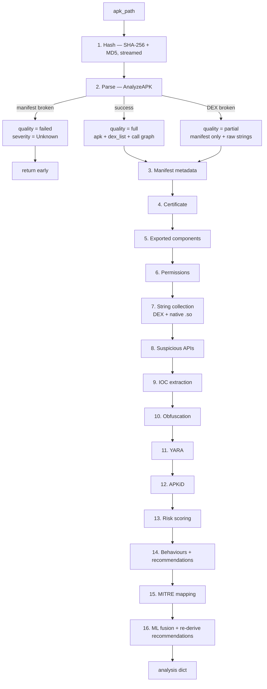
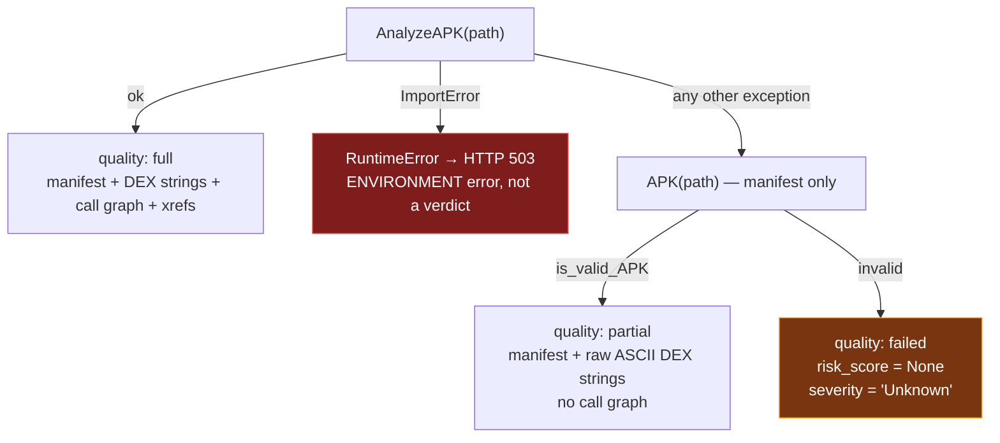
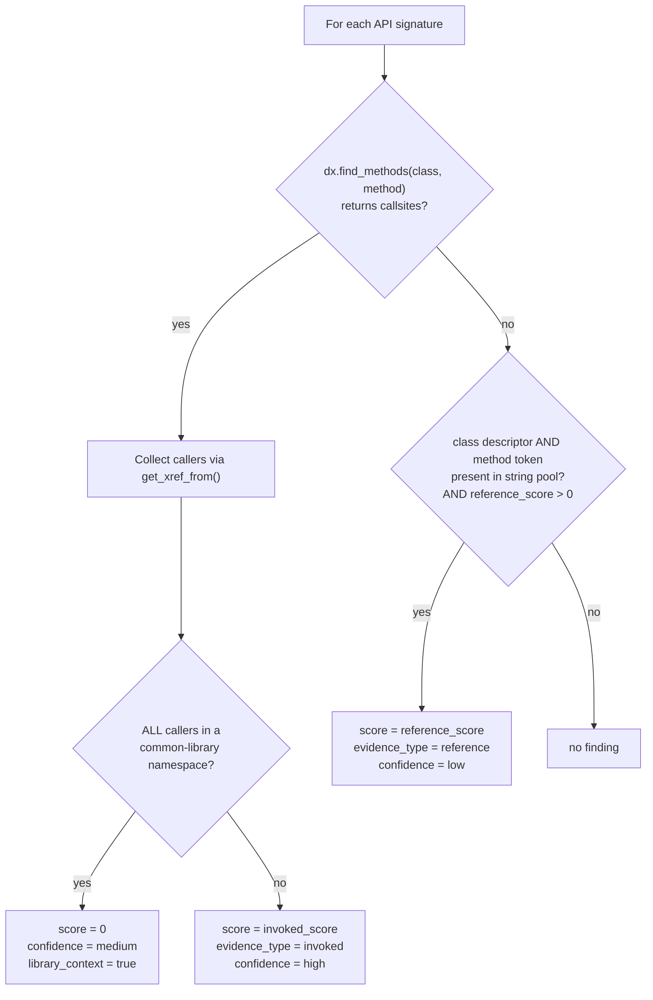

# 04 — The Static Analysis Pipeline

> Every stage of `static_analyzer.analyze()`, in execution order, with the exact logic,
> the reasoning behind it, and the failure behaviour.

Source: [`backend/app/analyzer/static_analyzer.py`](../backend/app/analyzer/static_analyzer.py)

---

## 1. Pipeline overview



Stages 3–12 are independent; each is wrapped so a failure adds an error entry rather
than aborting. Stage 13 consumes all of them.

---

## 2. Stage 1 — Identity and hashing

```python
sha256 = hashlib.sha256(); md5 = hashlib.md5()
for chunk in iter(lambda: fh.read(1 << 20), b""):
    sha256.update(chunk); md5.update(chunk)
```

Streamed in 1 MiB blocks so a 200 MB APK costs 1 MiB of memory, not 200. **SHA-256** is
the canonical identifier used for VirusTotal lookups, blocklist recommendations, and
dataset labelling. **MD5** is retained solely because many threat-intel feeds and
existing bank blocklists are still keyed on it — never for integrity decisions.

---

## 3. The degradation ladder

The most important structural idea in the pipeline. Malformed samples are the norm, not
the exception, and **a parse failure must never be reported as a clean bill of health.**



### The three rungs

| Rung | `analysis_quality` | Available evidence | Score | Severity |
|---|---|---|---|---|
| **Full** | `full` | Manifest, decoded DEX strings, class list, **call graph with xrefs** | computed | Low…Critical |
| **Partial** | `partial` | Manifest, **raw ASCII strings scraped from DEX bytes**, no call graph | computed | Low…Critical + an explicit warning recommendation |
| **Failed** | `failed` | Nothing usable | `None` | `Unknown` |

### Why each rung exists

- **Full → partial.** A deliberately corrupted or exotically packed DEX breaks
  bytecode decoding, but the manifest is usually still intact and the DEX bytes still
  contain readable strings. Discarding that evidence would reward the evasion.
  `_collect_raw_dex_strings()` reads archive entries and regex-scans for printable ASCII
  runs — it *never* interprets an instruction — bounded to 8 files, 32 MiB, 12 000
  strings.
- **Partial reduces confidence honestly.** `analysis_coverage.dex_control_flow` is
  `false`, so API findings can only be `reference`-level (low confidence, reduced
  weight), and the recommendation list gains: *"DEX control-flow analysis was
  incomplete; manually review with another decompiler and use isolated dynamic analysis
  before clearing this sample."* The Gemini verdict policy independently downgrades a
  partial analysis to `Inconclusive`.
- **Failed is `Unknown`, never `Low`.** This is called out in a code comment because it
  is the single most dangerous possible bug in a triage tool: reporting an unparseable
  sample as low risk. `risk_score` is `null` and the severity string is `Unknown`.
- **`ImportError` is a 503, not a verdict.** If androguard itself is missing (the
  classic "started uvicorn from the wrong Python" mistake), the server refuses to
  analyse rather than returning a meaningless clean result. `/api/health` exposes
  `analyzer_ready` and the dashboard shows an "Engine offline" badge.

---

## 4. Stage 3 — Manifest metadata

Extracted defensively via a `_safe(fn, default)` wrapper that swallows any exception and
substitutes a default:

```python
manifest = {
    "package_name": _safe(a.get_package, ""),
    "app_name":     _safe(a.get_app_name, ""),
    "version_name": _safe(a.get_androidversion_name, ""),
    "version_code": _safe(a.get_androidversion_code, ""),
    "min_sdk":      _safe(a.get_min_sdk_version, ""),
    "target_sdk":   _safe(a.get_target_sdk_version, ""),
    "main_activity":_safe(a.get_main_activity, ""),
    "activities": …, "services": …, "receivers": …, "providers": …,
}
```

**Analytic value beyond metadata:**

- **`main_activity` absent + services/receivers present** = an app with no launcher
  entry point. Combined with `RECEIVE_BOOT_COMPLETED` this is a background-only,
  boot-persistent app — a correlation rule fires (+8).
- **`target_sdk` far below current** is a deliberate evasion: older target SDKs escape
  newer platform restrictions (scoped storage, background limits, implicit-export
  defaults).
- **Component counts** feed the attack-surface stage and the report.

---

## 5. Stages 4–5 — Certificate and attack surface

### 5.1 Certificate ([`cert_analysis.py`](../backend/app/analyzer/cert_analysis.py))

Self-signing is **not** flagged — it is universal on Android. Only genuine anomalies
score, capped at 12 points:

| Flag | Meaning |
|---|---|
| Android debug certificate | `CN=Android Debug` on a distributed app — rushed repackaging |
| Generic/placeholder subject | `CN=Unknown`, empty organisation fields |
| Anomalous validity window | Absurdly long, or already expired at analysis time |

### 5.2 Exported components ([`components.py`](../backend/app/analyzer/components.py))

Walks the manifest for `activity`, `activity-alias`, `service`, `receiver`, `provider`
and determines export status:

```python
if exported_attr is not None:
    is_exported = exported_attr.lower() == "true"
else:
    is_exported = has_intent_filter    # implicit export, pre-Android 12
```

Unguarded (no `android:permission`) non-activity components score: **provider +4**,
**service/receiver +2**, capped at 10. Launcher activities are expected and never
scored.

> **Deliberate design decision:** exported components are a **vulnerability** in the app,
> not evidence that the app is **malicious**. `risk_scoring.py` therefore reports them
> but does **not** add them to the malware risk total — there is an explicit comment
> saying so. Conflating "insecure" with "malicious" was measured as a false-positive
> source on legitimate apps.

---

## 6. Stage 6 — Permissions

[`permissions.py`](../backend/app/analyzer/permissions.py) holds a catalog of
`name → (score, category, why-it-matters)`. Matching is on the **last dot-segment**, so
both `android.permission.READ_SMS` and vendor-prefixed variants are caught.

### The weight table, by category

| Category | Permission | Weight | Rationale |
|---|---|---:|---|
| Accessibility | `BIND_ACCESSIBILITY_SERVICE` | **20** | Highest single weight — full screen read + input injection |
| SMS | `READ_SMS`, `RECEIVE_SMS` | 15 | Classic OTP theft |
| SMS | `SEND_SMS` | 12 | Premium fraud / spreading |
| SMS | `RECEIVE_MMS`, `WRITE_SMS` | 8 | |
| DeviceAdmin | `BIND_DEVICE_ADMIN` | 15 | Lock/wipe, anti-removal |
| Contacts | `READ_CONTACTS` | 10 | Phishing / victim spreading |
| Telephony | `READ_CALL_LOG` | 10 | |
| Telephony | `CALL_PHONE`, `PROCESS_OUTGOING_CALLS` | 8 | Toll fraud, call interception |
| Dropper | `REQUEST_DELETE_PACKAGES` | 8 | Disable security tools |
| Contacts | `WRITE_CONTACTS` | 6 | |
| Notifications | `READ_NOTIFICATION_POLICY` | 6 | |
| Dropper | `REQUEST_INSTALL_PACKAGES` | 5 | Legitimate in stores/file managers |
| Telephony | `READ_PHONE_NUMBERS` | 5 | |
| Surveillance | `RECORD_AUDIO`, `ACCESS_BACKGROUND_LOCATION` | 5 | |
| **Overlay** | `SYSTEM_ALERT_WINDOW` | **4** | Deliberately low — see below |
| Persistence | `RECEIVE_BOOT_COMPLETED` | 3 | Extremely common scheduling capability |
| Telephony | `READ_PHONE_STATE` | 3 | Historically ubiquitous in ad SDKs |
| Contacts | `GET_ACCOUNTS` | 3 | |
| Surveillance | `ACCESS_FINE_LOCATION` | 3 | |
| Storage | `MANAGE_EXTERNAL_STORAGE` | 3 | |
| Surveillance | `CAMERA` | 2 | |
| Recon | `QUERY_ALL_PACKAGES` | 2 | Legitimate for launchers/password tools |
| Storage | `READ_EXTERNAL_STORAGE` | 1 | |
| — | `WRITE_EXTERNAL_STORAGE`, `FOREGROUND_SERVICE` | **0** | Report-only |
| — | `INTERNET`, `ACCESS_NETWORK_STATE` | **absent** | Context inputs, never findings |

### Three calibration decisions worth internalising

1. **`SYSTEM_ALERT_WINDOW` is only 4 points.** Overlay is the mechanism of the most
   damaging attack in the taxonomy, yet it is scored low — because chat heads, screen
   filters, floating players, and accessibility tools all use it. Its danger is
   recovered through correlation (+8 with accessibility, +6 with financial keywords),
   not through its base weight.
2. **`INTERNET` is not in the table at all.** Scoring a permission that ~every app
   requests adds a constant to every score, which shifts the whole distribution without
   improving separation. It is used *only* as a context input to correlation rules.
3. **Zero-weight entries are kept, not deleted.** `WRITE_EXTERNAL_STORAGE` still appears
   in the report as visible context; it just contributes nothing. Visibility and scoring
   are separate concerns throughout this codebase.

---

## 7. Stage 7 — String collection

Three separate collectors feed everything downstream.

| Collector | Source | Bounds | Used when |
|---|---|---|---|
| `_collect_dex_strings` | `dex.get_strings()` + `dx.get_strings()` | deduplicated set | quality = `full` |
| `_collect_raw_dex_strings` | ASCII runs (`[\x20-\x7e]{5,}`) in raw `.dex` archive entries | 8 files, 32 MiB, 12 000 strings | quality = `partial` |
| `_collect_native_strings` | ASCII runs in `lib/**/*.so` | 8 files, 8 MiB each, 4 000 strings | always |

Routing of the results:

```
dex_strings                    → API detection (call graph is DEX-only)
dex_strings + native_strings   → IOC extraction, YARA scanning
dex_strings                    → obfuscation entropy + dynamic-loading markers
```

Native strings are included in IOC/YARA scanning because C2 URLs are routinely moved
into native libraries specifically to defeat DEX-only string scanners.

---

## 8. Stage 8 — Suspicious API detection

Source: [`api_patterns.py`](../backend/app/analyzer/api_patterns.py)

### 8.1 The two-tier evidence model

Each signature is `(label, class_regex, method_regex, invoked_score, reference_score,
behaviour)`. Detection proceeds in order:



### 8.2 The signature table

| Label | Invoked | Reference | Behaviour |
|---|---:|---:|---|
| `AccessibilityService` | 18 | 6 | Screen scraping / auto-click fraud |
| `SmsManager.sendTextMessage` | 15 | 4 | OTP relay / premium fraud |
| `DexClassLoader` | 12 | 4 | Hides second-stage payload |
| `DevicePolicyManager abuse` | 6 | 0 | Lock/wipe / anti-removal |
| `NotificationListenerService` | 5 | 1 | OTP risk needs fraud context |
| `Runtime.exec`, `ProcessBuilder` | 3 | 0 | Shell/process execution |
| `PathClassLoader` | 3 | 1 | Dynamic class loading |
| `Settings.canDrawOverlays` | 2 | 0 | Overlay attack setup |
| `Clipboard read`, `Telephony identifiers`, `WebView.addJavascriptInterface`, `PackageManager.setComponentEnabledSetting` | 1 | 0 | Contextual only |
| `HttpURLConnection`, `OkHttp`, `Raw Socket`, `Cipher operation` | 0 | 0 | Report-only context |

### 8.3 Three precision mechanisms

**(a) Exact method matching, not class matching.** `DevicePolicyManager abuse` matches
only `lockNow|wipeData|resetPassword|setActiveAdmin|setDeviceOwner`. Merely *touching*
the class (as any MDM-aware app does) is not a finding.

**(b) Library-context suppression.** For `DexClassLoader`/`PathClassLoader`, if every
recovered caller starts with `Landroid/`, `Landroidx/`, `Lcom/android/`,
`Lcom/google/android/gms/`, `Lcom/google/firebase/`, `Lcom/facebook/`, `Lcom/unity3d/`,
`Lokhttp3/`, `Lorg/apache/`, `Lkotlin/`, or `Lkotlinx/`, the score becomes 0 and the
evidence string reads *"N common-library call site(s); report-only"*. Framework module
loading is not a dropper.

**(c) Reference evidence requires both tokens.** A `reference` finding needs the class
descriptor **and** the specific method token in the string pool — unless the signature's
method pattern is `.*` (capability classes like `AccessibilityService`, where subclassing
means there is no method to name).

Output includes `invoked_count` and `reference_count` so the report and the score engine
can always distinguish observed behaviour from mere capability.

---

## 9. Stage 9 — IOC extraction

Source: [`iocs.py`](../backend/app/analyzer/iocs.py)

### 9.1 Base64 / hex auto-decode

Before scanning, `_decode_candidates()` finds strings 16–2048 chars that look like
Base64 (`^[A-Za-z0-9+/]{16,}={0,2}$`, length % 4 == 0) or hex (`^([0-9a-fA-F]{2}){8,}$`),
decodes them, and keeps results that are ≥4 chars and **>85 % printable**. Up to 400
decoded blobs are appended to the scan set. The printable-ratio test is what stops random
binary from producing garbage matches.

This directly counters the most common IOC-hiding technique. The count is surfaced as
`iocs.decoded_blobs` so an analyst can see that decoding contributed.

### 9.2 Extractors

| Extractor | Pattern / logic |
|---|---|
| URLs | `https?://[^\s"'<>)\]]+`, trailing punctuation stripped |
| IPs | Dotted quad; `0.*`, `127.*`, `255.*`, `0.0.0.0` discarded as noise |
| **Domains** | **Derived only from real URLs** — see below |
| Telegram tokens | `\d{8,10}:[A-Za-z0-9_-]{35}` |
| Firebase | `https://[a-z0-9-]+\.firebaseio\.com` |
| Secrets | `(api[_-]?key\|secret\|token\|password\|bearer)\s*[=:]\s*['"]?([A-Za-z0-9_\-]{12,})` |
| Keywords | 26 terms, **word-boundary matched** |

### 9.3 Two false-positive fixes that materially changed results

**(a) Domains come only from URLs.** A bare-string domain regex was matching Java package
names — `android.app`, `kotlinx.coroutines.io`, `libcore.icu.icu` — because `.app`,
`.io`, `.icu`, and `.cc` are all real TLDs. Benign apps were flooded with dozens of fake
IOCs. Domains are now extracted from the host component of already-found URLs only.

**(b) Keywords are word-boundary matched.** Substring matching found `upi` inside
"gro**upi**ng" and "occ**upi**ed", and `otp` inside "cry**ptō**"-adjacent tokens. Every
keyword is now a precompiled `\b…\b` regex.

### 9.4 Benign-domain allowlisting, done safely

```python
def _is_benign_domain(d):
    dl = d.lower()
    return any(dl == s or dl.endswith("." + s) for s in BENIGN_DOMAIN_SUFFIXES)
```

The DNS **label boundary** (`"." + suffix`) is essential. A plain `endswith` check would
trust an attacker domain named `notgoogle.com` because it ends with `google.com`. Allowed
suffixes are platform/SDK infrastructure: `schemas.android.com`, `w3.org`, `apache.org`,
`google.com`, `googleapis.com`, `gstatic.com`, `android.com`, `github.com`, `json.org`,
`slf4j.org`, `bouncycastle.org`.

### 9.5 URL triage with visible reasons

`_url_risk(url)` returns a list of human-readable reasons rather than an opaque number:

| Reason | Trigger |
|---|---|
| `literal IP host` / `private/local IP host` | Host parses as an IP address |
| `higher-risk .<tld> domain` | TLD in `{xyz, top, tk, ml, ga, cf, gq, icu, vip, cc, fun}` |
| `internationalized/punycode domain` | Host contains `xn--` |
| `fraud/C2-like path` | Path matches `login\|signin\|verify\|bank\|otp\|upload\|exfil\|gate\|panel\|c2\|beacon` at a delimiter boundary |
| `non-standard port N` | Port present and not 80/443 |
| `credentials embedded in URL` | `user:pass@` present |
| `cleartext HTTP` | Scheme is `http` **and** at least one other reason already fired |

Confidence is `medium` if a stronger reason (literal IP, punycode, embedded credentials,
higher-risk TLD) is present, otherwise `low`. Score is
`min(2 + max(0, len(reasons) - 1), 5)` — capped low, because **a URL is weak evidence**.
Only `medium`/`high` confidence URLs contribute to the score at all.

> A TLD is not malicious. The higher-risk TLD list exists to *rank* triage output, never
> to produce a verdict on its own — the code comment says exactly this.

### 9.6 Keyword scoring policy

26 keywords are extracted and reported; only a 12-term **financial** subset (`otp`,
`cvv`, `ifsc`, `upi`, `aadhaar`, `netbanking`, `mpin`, `debit`, `credit card`,
`card number`, `account number`, `passcode`) can influence anything — and even those
score **zero on their own**. They only matter through a correlation rule or a
capability-qualified YARA match.

Reason: generic credential words (`login`, `password`, `username`) appear in nearly every
app, in every UI translation file, in every password manager and authenticator. Scoring
them was a measured false-positive source. The relevant block in `risk_scoring.py` is a
comment explaining the deliberate absence of scoring.

---

## 10. Stage 10 — Obfuscation

Source: [`obfuscation.py`](../backend/app/analyzer/obfuscation.py). Capped at 18;
`is_obfuscated` is `True` at ≥10.

| Signal | Condition | Points |
|---|---|---:|
| Multiple DEX files | `dex_count > 1` | **0** — multidex is routine past the 64K method limit |
| Native libraries | any `.so` | **0** — common in games, media, crypto, ML |
| Heavy name obfuscation | >55 % of classes have 1–2-character names | 2, or **5** if >75 % |
| Dynamic DEX loading | `DexClassLoader` in strings | 8 (**0** if library-context) |
| In-memory DEX loading | `InMemoryDexClassLoader` in strings | 8 (**0** if library-context) |
| High-entropy strings | ≥25 candidates **and** ratio ≥35 % | 2, or **5** if ratio ≥60 % |

### The entropy signal, in detail

Candidates are strings of length 24–512 with no spaces. Shannon entropy is computed as
`-Σ p·log₂p` over the character distribution; >4.5 bits/char marks a string as
high-entropy.

The crucial refinement is that the trigger is a **ratio**, not an absolute count. A large
ad-heavy app naturally contains hundreds of hashes, base64 assets, and identifiers; an
absolute threshold made every big app "look packed". Requiring ≥35 % of candidates to be
high-entropy makes the signal scale-invariant.

Similarly, reflection and `System.loadLibrary` were **removed** as signals — they appear
in virtually every app via AndroidX and Kotlin, and R8/ProGuard minification shortens
names in nearly every *release* build, which is why the name-obfuscation threshold is set
as high as 55 %.

---

## 11. Stage 11 — YARA

Source: [`yara_scan.py`](../backend/app/analyzer/yara_scan.py),
rules: [`android_fraud.yar`](../backend/app/rules/android_fraud.yar)

Rules are compiled once and cached. The scan target is a synthetic text blob:

```python
blob_parts  = list(dex_strings + native_strings)
blob_parts += [f"MANIFEST_PERMISSION:{p}" for p in permissions]
blob_parts += [package_name]
```

**The `MANIFEST_PERMISSION:` prefix is a security control.** Without namespacing, a
permission *string constant* embedded inside a third-party dependency would look
identical to a permission the app actually *declares*, letting a library's constants
trigger a capability rule. The prefix makes declared capability distinguishable from
incidental text.

### The ruleset

| Rule | Score | Detects |
|---|---:|---|
| `Accessibility_Overlay_Trojan` | 25 | Accessibility + overlay — auto-click / fake login |
| `SMS_OTP_Stealer` | 20 | SMS interception + network channel |
| `Dynamic_Dropper` | 18 | Runtime DEX loading + install-packages |
| `Telegram_C2_Exfil` | 18 | Telegram bot API as C2 |
| `Notification_Listener_Theft` | 15 | Notification reading for OTP/alerts |
| `Device_Admin_AntiRemoval` | 12 | Device-admin lock/wipe, uninstall resistance |
| `Banking_Credential_Keywords` | 10 | Hardcoded banking/credential vocabulary |

Each rule carries `description`, `severity`, `attack` (ATT&CK ID), and `score` metadata,
all surfaced in the report. Category cap: 40.

### API-compatibility note

Installing `apkid` pulls in `yara-python-dex`, which changes the string-match API.
`_matched_identifiers()` handles both shapes — newer `StringMatch` objects with
`.identifier`, and older `(offset, identifier, data)` tuples — and decodes bytes
identifiers. This is a real dependency interaction, documented in `CLAUDE.md`.

---

## 12. Stage 12 — APKiD

Source: [`apkid_scan.py`](../backend/app/intel/apkid_scan.py)

APKiD ("the PEiD of Android") fingerprints the **toolchain** that produced the APK:
compiler, packer, protector, obfuscator, and anti-analysis techniques.

| Category | Meaning | Scoring |
|---|---|---|
| Packer / Protector / Dropper | Commercial or custom packing (Jiagu, Bangcle, ApkProtect…) | Scored — packing hides the real payload |
| Anti-VM / anti-debug / anti-emulator | Evasion checks | Scored but **capped by category** so a dozen anti-VM strings can't dominate |
| Compiler | dx, dexlib, r8, jack | Informational — `dexlib` implies the APK was rebuilt by a tool like apktool, i.e. repackaged |

Overall cap: 30 points. The category cap on anti-VM matters because obfuscators emit many
similar checks; without it, one protected-but-benign app (like OWASP UnCrackable) would
score as malicious.

---

## 13. Stages 13–16 — Scoring, behaviours, MITRE, ML

Stage 13 (`risk_scoring.compute_risk`) is large enough to warrant its own chapter:
[05 — Risk Scoring](05-risk-scoring.md).

### Stage 14 — Behaviour labels

`derive_behaviors()` converts raw findings into analyst-readable labels. It is *not* a
score input — it feeds the report, the ATT&CK mapping, and the recommendations.

| Label | Condition |
|---|---|
| OTP / SMS theft | SMS permissions or `SmsManager.sendTextMessage` |
| Accessibility abuse (screen scraping / auto-click) | accessibility permission or API |
| Potential overlay attack (fake login screen) | overlay **+** (accessibility **or** financial keywords) |
| Overlay capability | overlay alone — deliberately weaker wording |
| Notification / alert stealing | `NotificationListenerService` |
| Dropper / dynamic payload loading | `DexClassLoader`, or install-packages + `PathClassLoader` |
| APK installation capability | install-packages alone |
| Potential command-and-control / data-exfiltration path | suspicious URLs **+** sensitive data access |
| Network communication capability / embedded endpoints | URLs or network APIs alone |
| Telegram-based C2 / exfiltration | Telegram token present |
| Contact harvesting / victim spreading | `READ_CONTACTS` |
| Code obfuscation / evasion | `is_obfuscated` |
| Device-admin abuse (anti-removal) | `BIND_DEVICE_ADMIN` or `DevicePolicyManager abuse` |

Note the paired labels — *"Potential overlay attack"* versus plain *"Overlay
capability"*. The language itself carries the confidence level, so a report never
overstates what the evidence supports.

### Stage 15 — MITRE mapping

Presentational only; see [02 §5](02-threat-model.md#5-full-mitre-attck-mobile-coverage-map).

### Stage 16 — ML fusion and recommendation refresh

`apply_ml()` may add up to 20 capped points, then recommendations are **re-derived**
against the possibly-changed severity — so the advice always matches the final verdict
rather than the pre-ML one. If quality was `partial`, the manual-review caveat is
appended last.

---

**Next:** [05 — Risk Scoring](05-risk-scoring.md) — how the numbers are actually made.
