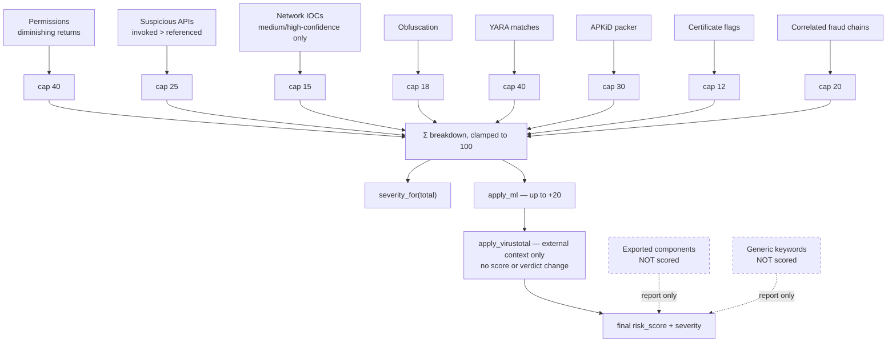

# 05 — Risk Scoring: The Rule Engine

> How ten independent evidence streams become one defensible number between 0 and 100,
> and why every design choice here is about **not lying to the analyst**.

Source: [`backend/app/analyzer/risk_scoring.py`](../backend/app/analyzer/risk_scoring.py)

---

## 1. The contract

The scorer promises four things:

1. **Every point is attributable.** `score_breakdown` is a list of
   `{category, points, detail}` and `sum(points) == risk_score` (before the 100 clamp).
   There is no hidden term anywhere in the system.
2. **No single feature can dominate.** Every category has a hard cap.
3. **Combinations outweigh accumulation.** Correlated fraud chains earn bonuses;
   stacking weak individual signals does not.
4. **A score is a triage ranking, not a probability.** It is never presented as
   "N % chance of malware", and *Confirmed Malicious* is unreachable by heuristics alone.

---

## 2. The fusion diagram



### Severity bands

| Score | Severity | Operational meaning |
|---:|---|---|
| 0–20 | **Low** | No strong indicators. Monitor. |
| 21–40 | **Medium** | Weak or incomplete suspicious evidence. Escalate if combined with other fraud signals. |
| 41–70 | **High** | Block the hash, blacklist the endpoints, notify the fraud/SOC team. |
| 71–100 | **Critical** | Same as High, plus customer-impact review. |
| `None` | **Unknown** | Analysis did not complete. **Never treat as clean.** |

The default evaluation decision threshold is **21** (Medium or above counts as flagged) —
see [13 — Evaluation](13-evaluation-and-accuracy.md).

---

## 3. Category caps and why they exist

```python
CATEGORY_CAPS = {
    "permissions": 40, "apis": 25, "network": 15,
    "obfuscation": 18, "keywords": 12, "yara": 40, "correlation": 20,
}
```

Without caps the score becomes a **feature-count proxy**: big apps score high because
they are big. Caps convert the score from "how much stuff is in here" into "how strong is
the strongest evidence in each independent category".

Two caps are deliberately asymmetric and worth explaining:

- **YARA at 40** — the highest, equal to permissions. YARA rules encode *combinations*
  already verified by a human rule author, so a single match is far more discriminative
  than a single permission.
- **Network at only 15** — the lowest of the substantive categories. Embedded URLs are
  the weakest evidence class in the entire system: every app has endpoints.

---

## 4. Per-category logic

### 4.1 Permissions — diminishing returns

```python
perm_weights = sorted(weights_of_dangerous_permissions, reverse=True)
perm_score  = perm_weights[0]                          # strongest at full value
perm_score += round(perm_weights[1] * 0.5)             # second at half
perm_score += round(sum(perm_weights[2:]) * 0.25)      # remainder at a quarter
perm_score  = min(perm_score, 40)
```

**Why.** A legitimate super-app (banking, super-wallet, social) genuinely requests many
sensitive permissions. Linear summation punished breadth rather than intent. Diminishing
returns preserve the strongest capability signal while refusing to let sheer count drive
the verdict.

**Worked example — a banking trojan:**

| Permission | Weight |
|---|---:|
| `BIND_ACCESSIBILITY_SERVICE` | 20 |
| `READ_SMS` | 15 |
| `RECEIVE_SMS` | 15 |
| `SYSTEM_ALERT_WINDOW` | 4 |
| `READ_CONTACTS` | 10 |

Linear sum would be 64 (capped to 40). Diminishing returns give
`20 + round(15×0.5) + round((15+10+4)×0.25) = 20 + 8 + 7 = 35`. The discriminative
strength lost here is deliberately restored by the correlation rules in §5 — which
require the *right* combination rather than merely many permissions.

### 4.2 Suspicious APIs

Straight sum of scored findings, capped at 25. Zero-weight findings are excluded from the
total but counted in the detail string:

> `"3 risk-relevant API(s); 5 report-only"`

That phrasing exists so an analyst can see the tool noticed `HttpURLConnection` and
consciously chose not to score it.

### 4.3 Network indicators

```
medium/high-confidence suspicious URLs → min(Σ url scores, 10)
Telegram bot token present             → +10
hardcoded secret(s) present            → +4
                                        → cap 15
```

Low-confidence URLs contribute **nothing**. A Telegram bot token alone is worth as much
as ten suspicious URLs, because it is one of the very few near-unambiguous artefacts in
this domain.

### 4.4 Obfuscation, YARA, APKiD, certificate

Pass-through of each stage's own score, clamped to its cap (18 / 40 / 30 / 12). The
per-stage logic already applied its own suppression rules — see
[04 §10–12](04-static-analysis-pipeline.md#10-stage-10--obfuscation).

### 4.5 What is deliberately **not** scored

| Not scored | Reason (from the code comments) |
|---|---|
| **Exported components** | A vulnerability in the app, not evidence the app is malicious. Reported, never added to malware risk. |
| **Generic keywords** | `login`/`password`/`username` appear in password managers, authenticators, payment libraries, and every UI translation file. |
| `INTERNET`, `ACCESS_NETWORK_STATE` | Requested by essentially every app. |
| Multi-DEX, native libraries | Routine engineering, not evasion. |
| Low-confidence URLs | Weakest evidence class. |
| Self-signed certificates | The Android norm. |
| MITRE techniques | Presentational mapping only. |

Every entry in that table is a false-positive source that was measured against the benign
corpus and removed. **The zeros are the accuracy work.**

---

## 5. Correlated fraud chains

The heart of the engine. Cap: 20.

| Chain | Condition | Points |
|---|---|---:|
| Invoked runtime loading + dropper/packer signature | `DexClassLoader` **invoked** AND (YARA `Dynamic_Dropper` OR APKiD category ∈ {Packer, Protector, Dropper}) | **+10** |
| SMS interception + outbound channel | SMS permission AND (`INTERNET` OR URLs OR invoked network API) | +8 |
| Accessibility automation + overlay | `BIND_ACCESSIBILITY_SERVICE` AND `SYSTEM_ALERT_WINDOW` | +8 |
| Package installation + runtime code loading | `REQUEST_INSTALL_PACKAGES` AND (`DexClassLoader` OR `PathClassLoader`) | +8 |
| Invoked runtime loading + obfuscated payload path | `DexClassLoader` **invoked** AND obfuscation ≥ 8 | +8 |
| Boot persistence + background-only entry points | *(nested)* `RECEIVE_BOOT_COMPLETED` AND services/receivers exist AND **no** `main_activity` | +8 |
| Financial targeting + credential/OTP capability | financial keywords AND (overlay OR accessibility OR SMS permission) | +6 |
| Notification access + suspicious outbound indicator | `NotificationListenerService` AND (scoreable URL OR Telegram token OR secret) | +5 |

### Three subtleties in this table

**(a) The strongest chains require *invoked* evidence, not references.** Note
`invoked_apis` rather than `apis` in the two `DexClassLoader` chains:

```python
invoked_apis = {a["api"] for a in suspicious_apis
                if a.get("evidence_type", "invoked") == "invoked"}
```

A string-pool mention of `DexClassLoader` cannot earn a +10 dropper bonus. Only a
recovered callsite can.

**(b) `has_network` is a genuine disjunction.** It is true if the app declares `INTERNET`
**or** embeds any URL **or** invokes `HttpURLConnection`/`OkHttp`/`Raw Socket`. Malware
can obtain a network channel several ways; requiring only the permission would miss the
others.

**(c) The boot-persistence chain is nested inside the obfuscated-loader chain.** It only
evaluates when the app has already demonstrated invoked runtime loading plus obfuscation.
"Starts on boot with no launcher icon" is common in legitimate background services
(sync adapters, wearable companions), so it is only meaningful once a strong prior exists.

### Why correlation instead of higher base weights

Consider two apps:

| | App A (password manager) | App B (banking trojan) |
|---|---|---|
| `SYSTEM_ALERT_WINDOW` | ✓ | ✓ |
| `BIND_ACCESSIBILITY_SERVICE` | ✓ (autofill) | ✓ |
| `READ_SMS` | ✗ | ✓ |
| Embedded Telegram token | ✗ | ✓ |
| Financial keywords | ✓ (vault fields) | ✓ |

Raising the base weight of overlay or accessibility punishes App A just as hard as App B.
The correlation rules fire on the *pattern* — accessibility + overlay + SMS + outbound
channel — which is exactly the shape App A does not have. **Separation, not severity, is
the goal.**

---

## 6. Optional VirusTotal corroboration

`apply_virustotal(analysis, vt)` runs **after** the rule engine, in `main.py`, and only
when `VT_API_KEY` is configured. Without a key it is a silent no-op. When configured,
the response is attached to `analysis["virustotal"]` for a separate analyst-facing
panel and report context.

```python
def apply_virustotal(analysis, vt):
    analysis["virustotal"] = vt
    return analysis
```

**Invariant:** external intelligence contributes zero points and cannot change severity
or the deterministic evidence assessment. The platform remains fully functional and
produces the same local verdict when VirusTotal is absent, unavailable, or disagrees.

---

## 7. ML fusion

`apply_ml(analysis, ml)` — see [08 — ML Classifier](08-ml-classifier.md) for the model.

```python
if prob >= threshold and prediction in ("flagged", "malware"):
    points = min(round(prob * 20), 20)
```

Four constraints, all deliberate:

1. **Capped at 20 points.** The model can never move a sample more than one severity band
   on its own.
2. **Threshold-gated** (default 0.8). Below threshold, the model contributes nothing.
3. **Explainable in the breakdown**, e.g. *"malware probability 91 % (threshold 80 %)"*,
   alongside `contributing_permissions` in the analysis object.
4. **Asymmetric by design.** A high probability adds risk; a low probability **never
   subtracts**. `classifier.py` states this explicitly: below-threshold means "no ML
   alert", not "this APK is benign". Other static evidence stands on its own.

---

## 8. Fully worked example

A repackaged banking trojan, quality `full`, no VirusTotal key, no ML model.

**Findings**

- Permissions: `BIND_ACCESSIBILITY_SERVICE` (20), `READ_SMS` (15), `RECEIVE_SMS` (15),
  `SYSTEM_ALERT_WINDOW` (4), `INTERNET` (not scored)
- APIs: `AccessibilityService` invoked (18), `SmsManager.sendTextMessage` invoked (15),
  `HttpURLConnection` invoked (0)
- IOCs: one Telegram bot token; one `http://panel.example.xyz/gate.php`
- Obfuscation: 68 % short class names (+2), high-entropy ratio 41 % (+2) → 4
- YARA: `SMS_OTP_Stealer` (20) + `Accessibility_Overlay_Trojan` (25) = 45 → capped 40
- Certificate: Android debug certificate (+6)
- APKiD: nothing

**Calculation**

| Category | Working | Points |
|---|---|---:|
| Dangerous permissions | `20 + round(15×0.5) + round((15+4)×0.25)` = 20+8+5 | **33** |
| Suspicious APIs | `18 + 15 + 0 = 33` → cap 25 | **25** |
| Network indicators | Telegram token 10 + URL (`higher-risk .xyz`, `fraud/C2-like path`, `cleartext HTTP`) score 4 | **14** |
| Obfuscation | 2 + 2 | **4** |
| YARA signatures | 20 + 25 = 45 → cap 40 | **40** |
| Certificate red-flags | debug certificate | **6** |
| Correlated fraud behaviours | SMS + outbound (8), accessibility + overlay (8), financial targeting + capability (6) = 22 → cap 20 | **20** |
| **Total** | 33+25+14+4+40+6+20 = 142 → **clamp 100** | **100** |

**Result:** `risk_score = 100`, `severity = "Critical"`.

**Behaviours:** OTP / SMS theft · Accessibility abuse · Potential overlay attack ·
Telegram-based C2 / exfiltration · Potential command-and-control path

**Verdict policy:** `Likely Malicious` — **not** `Confirmed Malicious`, because no
independent multi-engine corroboration exists. This is the point of the whole design: a
perfect 100 from our own heuristics still does not license the word *confirmed*.

### Contrast: a benign authenticator (Aegis)

| Category | Points |
|---|---:|
| Dangerous permissions (`CAMERA` 2, `RECEIVE_BOOT_COMPLETED` 3) | ~4 |
| Suspicious APIs (clipboard 1, cipher 0) | 1 |
| Network indicators (no scoreable URLs) | 0 |
| Obfuscation (R8 minified, below 55 % threshold) | 0 |
| YARA (`Banking_Credential_Keywords` needs capability qualification — no match) | 0 |
| Correlation (no chain completes: no SMS permission, no overlay, no accessibility) | 0 |
| **Total** | **~5 → Low** |

The OTP vocabulary, cryptography, boot receiver and clipboard access that make this app
*look* like a trojan to a naive scanner all land in report-only, unscored territory.

---

## 9. Measured calibration effect

From [ROBUSTNESS_PLAN.md](../ROBUSTNESS_PLAN.md), the local regression set before and
after the Phase-1 calibration described above:

| Sample | Expected role | Before | After |
|---|---|---:|---:|
| Synthetic fraud fixture | Strong suspicious fixture | 100 / Critical | 100 / Critical |
| Packed dropper `.w.apk` | Malicious/dropper regression | Critical | 76 / Critical |
| OpenCalculator | Known benign | 38 / Medium | **17 / Low** |
| Outfit7 legacy ad-heavy app | Known benign stress case | 66 / High | **20 / Low** |

True positives held; false positives collapsed. **These four samples are smoke tests, not
publishable accuracy evidence** — the honest framing is in
[13 — Evaluation](13-evaluation-and-accuracy.md).

---

## 10. Recommendations

`recommendations(severity, behaviors, ioc_result)` maps the verdict to actions,
de-duplicated with order preserved:

| Trigger | Recommendation |
|---|---|
| High / Critical | Block the APK SHA-256 across endpoints |
| High / Critical | Blacklist contacted domains/IPs at the network gateway |
| High / Critical | Notify the bank fraud-monitoring / SOC team |
| Behaviour: OTP / SMS theft | Alert affected customers; review recent OTP-based transactions |
| Telegram token present | Report the bot token to the platform for takedown |
| always | Submit the sample to a malware-intelligence platform |
| Low / Medium | Monitor; escalate if combined with other fraud signals |
| quality = `partial` | Manually review with another decompiler; use isolated dynamic analysis before clearing |

Recommendations are recomputed **after** ML fusion so they always reflect the final
severity.

---

**Next:** [06 — GenAI Reporting](06-genai-reporting.md).
