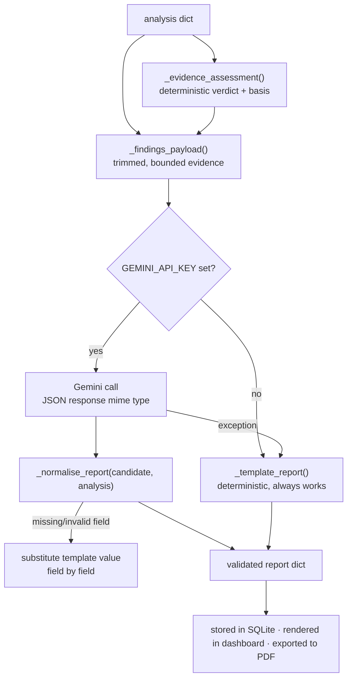

# 06 — Generative-AI Report Generation

> How extracted findings become an analyst-grade narrative, and how the system stays
> truthful when the model is unavailable, wrong, or manipulated.

Source: [`backend/app/genai/gemini_client.py`](../backend/app/genai/gemini_client.py)

---

## 1. What the LLM is for — and what it is not for

| The model **does** | The model **never** |
|---|---|
| Write an executive summary a fraud manager can read | Compute or alter the risk score |
| Correlate findings into a technical narrative | Decide the severity band |
| Reconstruct a plausible attack chain | See the APK, its bytes, or its file path |
| Phrase recommended actions | Introduce indicators that are not in the findings |
| Choose a threat-assessment label from a fixed set | Escalate past the evidence-backed ceiling |

The scoring engine has already reached a verdict before the model is invoked. The model's
job is **communication and correlation**, not adjudication.

---

## 2. The generation flow



The critical property: **there is no path through this diagram that returns nothing.**
Missing key, network failure, malformed JSON, hallucinated field — every branch converges
on a usable report.

---

## 3. The evidence-assessment policy

Before the model is consulted, the server decides — deterministically — what verdict the
evidence can actually support.

```python
def _evidence_assessment(analysis) -> tuple[str, str]:
    if not analysis.get("valid_apk", True) or analysis.get("risk_score") is None:
        return "Inconclusive", "analysis did not complete"
    malicious = virustotal.file.malicious if found else 0
    if malicious >= 5:
        return "Confirmed Malicious", f"{malicious} VirusTotal engines reported malicious"
    if severity in ("High", "Critical"):
        return "Likely Malicious", "high-confidence heuristic/corroborated evidence"
    if analysis.get("analysis_quality") == "partial":
        return "Inconclusive", "partial analysis; DEX control-flow could not be recovered"
    if severity == "Medium":
        return "Suspicious", "weak or incomplete suspicious evidence"
    return "No Strong Malicious Evidence", "no strong indicators found in static analysis"
```

### The verdict ladder

| Verdict | Reachable how |
|---|---|
| **Confirmed Malicious** | **Only** ≥5 independent VirusTotal engines. Unreachable by our own heuristics at any score. |
| Likely Malicious | Severity High or Critical |
| Suspicious | Severity Medium |
| Inconclusive | Analysis failed, or DEX control-flow unrecoverable |
| No Strong Malicious Evidence | Severity Low with a complete analysis |

Two details are load-bearing:

- **Partial analysis outranks a Medium verdict.** The `partial` check sits *above* the
  Medium branch, so an incomplete analysis is `Inconclusive` rather than `Suspicious`.
  Incomplete evidence must not masquerade as weak evidence.
- **The bottom rung is "No Strong Malicious Evidence", never "Benign".** A static
  analyzer cannot prove absence. The wording says exactly what was observed.

Both the verdict and its `assessment_basis` are passed into the prompt, and the system
prompt independently instructs: *"Use Confirmed Malicious only when the findings
explicitly say confirmation evidence is present; a heuristic score alone can support
Likely Malicious, never confirmation."* Policy is enforced in code **and** restated in
the prompt — belt and braces.

---

## 4. The findings payload

`_findings_payload()` builds a **new dict** containing only named, bounded fields. Nothing
is passed through by reference, so no path, byte buffer, or unexpected key can leak.

```python
{
  "package_name", "app_name", "sha256",
  "risk_score", "severity", "analysis_quality", "analysis_errors",
  "evidence_assessment", "assessment_basis",
  "score_breakdown",
  "dangerous_permissions": [{"name", "reason"}],
  "suspicious_apis":       [{"api", "behaviour"}],
  "network_indicators": {"domains"[:30], "ips"[:30], "urls"[:30], "telegram_tokens": bool},
  "obfuscation_signals", "certificate_flags", "exported_components", "decoded_blobs",
  "suspicious_keywords"[:20],
  "heuristic_behaviors",
  "yara_matches": [{"rule", "description"}],
  "mitre_attack":  [{"id", "name"}],
  "apkid",
  "ml_verdict": {"prediction", "malware_probability"} | None,
  "virustotal": summary | None,
  "agentic_investigation": summary | None,
}
```

Three things to notice:

- **`telegram_tokens` is a boolean, not the token.** The report should say *a Telegram bot
  token was found*; it must not ship a live credential into a third-party API.
- **Everything is capped** (30 domains, 30 IPs, 30 URLs, 20 keywords) so a sample with
  thousands of extracted strings cannot blow the context window or the bill.
- **The agentic summary is compact** — hypotheses, confidence, evidence gaps — with the
  operational audit trail (tool names, durations, rejections) deliberately excluded. It
  is operational telemetry for the dashboard, not report content.

---

## 5. The system prompt

```
You are a senior mobile-malware analyst supporting a bank's fraud and SOC teams.
You are given STRUCTURED FINDINGS extracted from static analysis of an Android APK
(permissions, suspicious APIs, network indicators, obfuscation signals and a rule-based
risk score). Reason like a malware analyst.

Return ONLY valid minified JSON (no markdown fences) with exactly these keys:
{
  "executive_summary":  "2-4 sentence plain-English verdict for a non-technical fraud manager",
  "technical_summary":  "1-2 paragraph technical explanation correlating the evidence into attack behaviour",
  "threat_assessment":  "one of: No Strong Malicious Evidence, Suspicious, Likely Malicious, Confirmed Malicious",
  "key_findings":       ["short bullet", "..."],
  "attack_chain":       ["ordered step the malware likely performs", "..."],
  "recommended_actions":["actionable step for the fraud/SOC team", "..."]
}
Be specific and evidence-driven. Do not invent indicators that are not in the findings.
Use Confirmed Malicious only when the findings explicitly say confirmation evidence is
present; a heuristic score alone can support Likely Malicious, never confirmation.
```

### Prompt-design decisions

| Technique | Why |
|---|---|
| **Explicit role + audience** ("senior analyst", "bank's fraud and SOC teams") | Sets register: neither academic nor alarmist |
| **Exact JSON schema in the prompt** | Makes structured parsing the default path rather than the exception |
| **Two audiences in one schema** (`executive_summary` vs `technical_summary`) | One report serves both the fraud manager and the SOC engineer |
| **`attack_chain` as an ordered list** | Forces causal reasoning over the findings instead of restating them |
| **Enumerated `threat_assessment` values** | A closed vocabulary can be validated; free text cannot |
| **"Do not invent indicators"** | Direct anti-hallucination instruction |
| **Explicit confirmation ceiling** | Prompt-level mirror of the code-level policy |

`response_mime_type: "application/json"` and `temperature: 0` are set on the API call, so
output is JSON-shaped and reproducible.

---

## 6. Output normalisation

Never trust model output. `_normalise_report(candidate, analysis)` builds the template
report first, then **fills each field from the model only if it validates**:

| Field | Validation |
|---|---|
| `executive_summary`, `technical_summary` | Non-empty string, else template value |
| `threat_assessment` | Must be one of the four allowed labels, else deterministic verdict |
| `key_findings`, `attack_chain`, `recommended_actions` | Must be a list of non-empty strings; coerced, bounded, else template list |

The result is **field-level degradation**: a response with a perfect summary but a
hallucinated `threat_assessment` keeps the summary and replaces just the bad field. It is
not all-or-nothing.

The report also carries a provenance marker — `generated_by: "template-fallback"` versus
the Gemini path — which the dashboard surfaces so an analyst always knows whether they
are reading model prose or deterministic text.

---

## 7. The template fallback

When no API key is configured, or Gemini fails, `_template_report(analysis)` composes a
complete report from the findings alone: severity, score, top breakdown categories,
detected behaviours, and the rule-based recommendations, assembled into the same six
fields.

This is not a stub. It is a **deliberate architectural guarantee**: the platform is fully
functional with zero API keys and zero network access. Adding Gemini improves the *prose*;
it does not add capability. Everything that is true of the sample is already computed
before the model is asked anything.

---

## 8. The optional cloud review pass

`review_investigation(analysis, investigation)` — gated behind `AGENT_GEMINI_REVIEW`
(default `false`).

When the [bounded local agent](07-agentic-investigation.md) has produced hypotheses using
a local Ollama model, this optional second pass sends **only the redacted extracted
findings** to Gemini for a critique: are the hypotheses supported by the cited evidence,
which are overreaching, what is missing?

Design constraints:

- **Off by default.** The default deployment keeps all evidence local.
- **Redacted payload only.** Same bounded findings object, never the evidence graph
  internals or raw strings.
- **Advisory output.** The review annotates the investigation; it cannot change the
  score, the severity, or the deterministic verdict.

---

## 9. Cost, latency, and failure

| Property | Behaviour |
|---|---|
| Tokens per report | Bounded by the capped payload — a handful of KB regardless of APK size |
| Determinism | `temperature: 0` |
| Latency | One call per analysis; not on any hot path (analysis dominates) |
| Timeout / quota / network failure | Caught, logged with `log.exception`, template fallback returned |
| Malformed JSON | `_normalise_report` substitutes field by field |
| Model unavailable entirely | Template path; `/api/health` reports `gemini_configured: false` |

**No LLM failure can fail an analysis request.** That property is what makes it safe to
call a third-party model inside a triage tool at all.

---

**Next:** [07 — Agentic Investigation](07-agentic-investigation.md).
