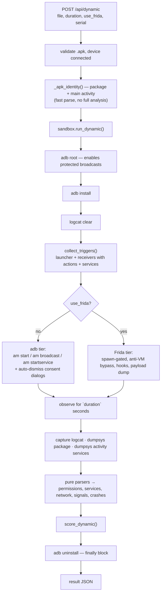

# 09 — Dynamic Analysis (the opt-in sandbox)

> The controlled exception to "never execute the APK". Everything in this chapter is
> about making that exception safe, explicit, and bounded.

Sources: [`backend/app/dynamic/`](../backend/app/dynamic/) —
`adb.py`, `sandbox.py`, `frida_runner.py`, `frida_hooks.js`, `frida_antivm.js`

---

## 1. The safety contract

Read this before anything else in the chapter.

| Rule | Enforcement |
|---|---|
| Execution **never** happens on the host | The APK is installed onto an Android device/emulator via `adb install`; the server process never runs it |
| Execution is **never** part of `/api/analyze` | Entirely separate endpoint `POST /api/dynamic`, separate module, separate code path |
| Execution requires an **explicit human action** | The dashboard has a distinct control; there is no automatic escalation from static to dynamic |
| Execution targets a **dedicated AVD** | Auto-selection matches only the AVD named by `SANDBOX_AVD` (default `FraudSandbox`). It deliberately does **not** fall back to an arbitrary attached device |
| Explicit device selection is **validated** | A caller-supplied serial must be in the currently connected set, else `400` |
| The device is left **clean** | Uninstall runs in a `finally` block |
| **Use an isolated AVD for real malware** | Stated in `CLAUDE.md`, the module docstrings, the endpoint docstring, and the dashboard |

The auto-selection rule deserves emphasis. From `_preferred_serial()`:

> *Deliberately does NOT fall back to an arbitrary device — auto-runs must target the
> isolated sandbox only, never (e.g.) the user's other emulators. To use a different
> device the caller must pass an explicit serial.*

Falling back to "whatever is attached" would be a one-line convenience that could install
live malware onto a developer's daily-driver emulator, or a physical phone plugged in for
unrelated reasons.

---

## 2. Why dynamic analysis exists here

Static analysis has a hard ceiling ([01 §7](01-foundations.md#7-why-static-analysis-works--and-where-it-fails)):

| Static blind spot | What runtime reveals |
|---|---|
| Packed / encrypted DEX | The unpacked payload in memory |
| Dropper second stage | The download and the `DexClassLoader` call, with the payload |
| Encrypted strings | Decrypted C2 URLs at the moment of use |
| Reflection-hidden calls | The actual invocation |
| Native-code logic | Observable side effects |

The tool is honest about this: a `partial` static analysis appends *"use isolated dynamic
analysis before clearing this sample"* to the recommendations, and the agent can formally
propose dynamic analysis via `request_dynamic_analysis` — as a **proposal a human
approves**, never an action it takes.

---

## 3. Architecture



### Pure parsers are separated from device I/O

`parse_granted_permissions`, `parse_services`, `parse_network`, `parse_runtime_signals`,
and `parse_crashes` are **pure functions over text**. They take a string and return
structured data, with no adb dependency at all — which is why
`backend/tests/test_dynamic_parsers.py` can unit-test the entire parsing layer **with no
emulator, no Android SDK, and no network**. Only orchestration needs a device.

This is the standard pattern for testing device-dependent code, and it is applied
consistently across the module.

---

## 4. The adb wrapper

Source: [`adb.py`](../backend/app/dynamic/adb.py)

```python
def _run(args, timeout=60, serial=None):
    ...
    return p.returncode, p.stdout or "", p.stderr or ""
```

Three properties, all defensive:

1. **Never raises.** Returns `(rc, stdout, stderr)`. Timeout → `-1`, adb missing → `-2`,
   anything else → `-3`. The orchestrator branches on codes instead of catching
   exceptions from a subprocess layer.
2. **Always times out.** Every call has an explicit timeout — a hung `adb shell` cannot
   wedge the request.
3. **UTF-8 with replacement.** `encoding="utf-8", errors="replace"`. logcat and dumpsys
   emit bytes that the Windows default codepage (cp1252) cannot decode, which crashed
   the run. Forcing UTF-8 with replacement fixes a real, platform-specific bug.

`adb` is located from `PATH`, else `ANDROID_HOME`/`ANDROID_SDK_ROOT` +
`platform-tools/adb[.exe]`.

---

## 5. Activation: making malware actually run

Naively running `am start` on the launcher activity misses a large class of samples.
Fraud APKs frequently have **no launcher icon at all** (hiding themselves) and activate
on broadcasts instead.

`collect_triggers(apk_path)` parses the APK for **every** entry point:

- the main/launcher activity,
- every `receiver` **and its declared intent-filter actions**,
- every `service`.

The runner then activates all of them: `am start` the activity, `am broadcast` each
declared action to each receiver, `am startservice` each service, plus a default action
set (bounded to 60 broadcasts total):

```python
_DEFAULT_TRIGGER_ACTIONS = [
    "android.intent.action.BOOT_COMPLETED",
    "android.intent.action.USER_PRESENT",
    "android.intent.action.MY_PACKAGE_REPLACED",
    "android.net.conn.CONNECTIVITY_CHANGE",
    "android.provider.Telephony.SMS_RECEIVED",
]
```

Two supporting mechanisms:

- **`adb root`** is attempted first, because `BOOT_COMPLETED` and similar are *protected
  broadcasts* that an unprivileged shell cannot deliver. Without root, boot-triggered
  droppers never wake up. It is a no-op on non-rootable images.
- **Consent-dialog auto-tap.** `dismiss_consent_dialogs()` taps positive-button labels
  (`Continue`, `Allow`, `While using the app`, `Only this time`, `Accept`, `OK`,
  `Agree`) for several rounds, so runtime permission modals do not stall the run.

---

## 6. Observation and parsing

Duration is clamped to **5–120 seconds** (`max(5, min(duration, 120))`). After the
observation window three sources are captured:

| Source | Command | Parser | Yields |
|---|---|---|---|
| Log stream | `adb logcat -d` | `parse_network`, `parse_runtime_signals`, `parse_crashes` | endpoints, behaviour signals, crashes |
| Package state | `dumpsys package <pkg>` | `parse_granted_permissions` | `granted=true` runtime permissions |
| Service state | `dumpsys activity services <pkg>` | `parse_services` | live `ServiceRecord` names |

### Reusing the static IOC engine

```python
def parse_network(logcat_text):
    iocs = ioc_mod.extract_iocs(logcat_text.splitlines())
    return {"urls": ..., "domains": ..., "ips": ...}
```

The **same** extractor, with the same allowlists and the same domain-from-URL-only rule,
is applied to runtime logs. Static and dynamic IOCs are therefore directly comparable —
and an endpoint that appears only at runtime is immediately visible as a decrypted or
downloaded C2.

### Runtime behaviour signals

| Signal | Detected from logcat | Points |
|---|---|---:|
| `sms_runtime` | `smsmanager`, `sendtextmessage`, `sms … sent` | **20** |
| `runtime_dex_load` | `dexclassloader`, `in-memory dex`, `dalvik…load` | **15** |
| `accessibility_runtime` | `accessibilityservice`, `accessibility event` | 12 |

---

## 7. Dynamic scoring

`score_dynamic()` produces its own 0–100 score with the same itemised-breakdown contract
as the static engine.

| Category | Weight | Cap |
|---|---:|---:|
| Network endpoint contacted | 8 each | 24 |
| Background service running | 6 each | 12 |
| Runtime DEX load | 15 | — |
| SMS activity at runtime | 20 | — |
| Accessibility at runtime | 12 | — |
| Dangerous permission actually granted | 3 each | 15 |
| Crash | 0 | informational |

Note the weights relative to static: **observed SMS sending scores 20 where the static
`SEND_SMS` permission scores 12.** Observed behaviour outranks declared capability — a
permission is intent, an observed send is fact.

`_DANGEROUS_RUNTIME` scores only permissions that were **actually granted at runtime**,
which is meaningfully stronger evidence than a manifest declaration: it means the user
was successfully socially engineered into granting them.

Dynamic scores are reported **separately** and are not folded into the static
`risk_score`. Merging a 15-second observation with a full static analysis into one number
would destroy the meaning of both.

---

## 8. The Frida tier

Source: [`frida_runner.py`](../backend/app/dynamic/frida_runner.py) + the two JS agents

Frida is a dynamic instrumentation toolkit that injects a JavaScript engine into a
running process, letting you hook arbitrary methods and observe arguments and return
values live.

### Requirements and graceful degradation

Needs `frida-server` running on the emulator, matching the installed `frida` version and
the device ABI. The project **does not auto-download it** — instead, when it is absent
the runner returns clear setup instructions rather than failing the request. Frida is
pinned to `16.7.19` in `requirements.txt` with an explicit comment:

> *pinned to 16.x — Frida 17 removed the global `Java` bridge needed by frida_hooks.js*

### What the hooks capture

| Event category | Score | Behaviour |
|---|---:|---|
| `sms` | 20 | SMS send at runtime (OTP exfiltration) |
| `dynamic_load` | 15 | Dynamic code loading at runtime |
| `exec` | 12 | Shell command execution at runtime |
| `network` | 8 | Network request at runtime |
| `clipboard` | 8 | Clipboard read at runtime |
| `crypto` | 4 | Encryption at runtime |

### Spawn-gating

The app is **spawned under Frida** rather than started and then attached. This matters
because the most interesting behaviour — unpacking, C2 resolution, anti-analysis checks —
happens in the first milliseconds of process start. Attaching afterwards misses it
entirely.

### Anti-VM bypass (`frida_antivm.js`)

Malware routinely refuses to run on an emulator: it checks `Build.FINGERPRINT`,
`Build.MODEL`, the presence of `qemu` properties, IMEI patterns, sensor availability. The
anti-VM agent hooks those checks and returns plausible physical-device values, so the
sample proceeds to its real behaviour instead of exiting silently.

### Payload capture

Hooks on the DEX-loading paths **dump the loaded payload** to disk. This is the single
highest-value output of the whole dynamic tier: for a dropper, it hands the analyst the
second stage — which can then be fed back through the static pipeline as a fresh sample.

Runtime C2 endpoints observed by the network hooks are surfaced separately as
`c2_endpoints`.

---

## 9. Result shape

```json
{
  "available": true, "ran": true, "serial": "emulator-5554",
  "package": "com.example.fraud", "duration": 15, "use_frida": true,
  "rooted": true, "has_launcher": false,
  "steps": ["installed", "hardened Frida run (...)", "frida: 2 dump(s), 3 C2 endpoint(s)"],
  "granted_permissions": ["RECEIVE_SMS", "READ_PHONE_STATE"],
  "services": ["com.example.fraud/.PersistService"],
  "network": {"urls": [...], "domains": [...], "ips": [...]},
  "runtime_signals": ["sms_runtime", "runtime_dex_load"],
  "crashes": [],
  "c2_endpoints": ["http://panel.example.xyz/gate.php"],
  "payload_dumps": ["/path/to/dump_1.dex"],
  "dynamic_score": 78,
  "score_breakdown": [{"category": "Sms Runtime", "points": 20, "detail": "observed in runtime logs"}, ...],
  "frida": {"ran": true, "events": [...], "antivm_applied": true}
}
```

Availability is checked before any work: `/api/health` reports
`dynamic: {available, reason, devices}` and `frida_available`, and the endpoint returns
`503` with the reason when no device is attached.

---

## 10. Setup

```powershell
# 1. Create a dedicated, isolated AVD named FraudSandbox
#    (or set SANDBOX_AVD to your own name)
.\scripts\setup_sandbox.ps1

# 2. Start it
emulator -avd FraudSandbox

# 3. Confirm the platform sees it
curl http://localhost:8000/api/health   # -> dynamic.available: true

# 4. Optional: Frida tier — push a matching frida-server and run it as root
adb push frida-server-16.7.19-android-x86_64 /data/local/tmp/frida-server
adb shell "chmod 755 /data/local/tmp/frida-server"
adb shell "su -c /data/local/tmp/frida-server &"
```

### Operational warnings

- **Use a throwaway AVD with no accounts, no real data, and a cold snapshot** you can
  restore between samples.
- **Do not attach a physical device** while dynamic analysis is enabled.
- Consider running the emulator on an isolated network segment; a live sample *will*
  contact its C2 if it can, and that contact tells the operator you exist.
- Real malware may attempt anti-uninstall via device admin — the AVD may need a wipe
  rather than a clean uninstall.

---

**Next:** [10 — API Reference](10-api-reference.md).
